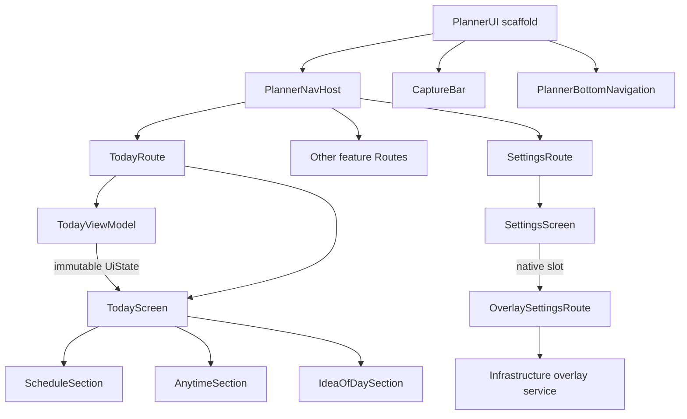

# Android package map

Updated 2026-10-29. Physical reorganization implemented and locally verified: 187 backend tests, 43 Android JVM tests, 25 distinct API 37 scenarios, debug/release builds and lint. Detailed scope and failed/repaired attempts are recorded in Testing. All paths below are inside android/app/src/main/java/app/planner. These are Kotlin packages inside the existing Gradle app module, not new Gradle modules.

## Ownership

| Package | Owns | Example |
| --- | --- | --- |
| domain/model | Framework-free records and registry values | Record.kt, RawNote.kt, TypeDefinition.kt |
| domain/policy, interpretation, time | Capture/completion/day/privacy rules, bounded local interpreter and canonical time | CaptureNote.kt, DayPolicy.kt, CaptureInterpreter.kt |
| application/port | Bounded reads, commands, atomic capture/approval and external capabilities | OrganizerQueries, OrganizerCommands, CaptureStore, CloudGateway, LocalDataGateway |
| application/usecase | Shared business workflows | CaptureUseCase, ApproveDevelopment |
| application/model | Plain application results/snapshots | AiPreview, DevelopmentSnapshot |
| infrastructure | Room/HTTP/sync/preferences/security/serialization/native overlay and DI | PlannerDatabase, StorageDao, PlannerRepository, SyncWorker, OverlayService |
| presentation/<feature> | Route, Screen, ViewModel, UiState, typed Actions and local components | today/TodayRoute, today/components/ScheduleSection |
| presentation/common, design | Shared lifecycle/UI coordination and reusable design primitives | FeatureViewModel, UiFeedback, PlannerCard, TaskCard |
| presentation/navigation, shell | Graph/destinations/bottom bar and Activity scaffold | PlannerNavHost, PlannerRoutes, PlannerUI |

Task/Event/Idea remain baseKind values of one Record and Type Registry contract. Separate kind-specific entities/repositories would duplicate current semantics, so the requested tree is adapted rather than copied literally. Both capture surfaces still call CaptureUseCase.

## Source tree

```text
app/planner/
├── application/
│   ├── model/
│   │   ├── AiPreview.kt
│   │   └── DevelopmentSnapshot.kt
│   ├── port/
│   │   ├── CaptureStore.kt
│   │   ├── CloudGateway.kt
│   │   ├── DevelopmentApprovalPort.kt
│   │   ├── InterpretationCodec.kt
│   │   ├── LocalDataGateway.kt
│   │   ├── OrganizerCommands.kt
│   │   ├── OrganizerQueries.kt
│   │   ├── SyncRequest.kt
│   │   └── UserPreferences.kt
│   └── usecase/
│       ├── ApproveDevelopment.kt
│       └── CaptureUseCase.kt
├── domain/
│   ├── interpretation/
│   │   └── CaptureInterpreter.kt
│   ├── model/
│   │   ├── CollectionCount.kt
│   │   ├── IdeaSlot.kt
│   │   ├── InterpretationHistory.kt
│   │   ├── Meta.kt
│   │   ├── OutboxOperation.kt
│   │   ├── ProfileSummary.kt
│   │   ├── RawNote.kt
│   │   ├── Record.kt
│   │   ├── StatusCount.kt
│   │   ├── TypeDefinition.kt
│   │   ├── UserCorrection.kt
│   │   └── UserRule.kt
│   ├── policy/
│   │   ├── CaptureNote.kt
│   │   ├── CapturePrivacy.kt
│   │   └── DayPolicy.kt
│   └── time/
│       └── Time.kt
├── infrastructure/
│   ├── database/
│   │   ├── dao/
│   │   │   ├── PlannerDao.kt
│   │   │   └── StorageDao.kt
│   │   ├── entity/
│   │   │   ├── CollectionCount.kt
│   │   │   ├── IdeaSlot.kt
│   │   │   ├── InterpretationHistory.kt
│   │   │   ├── Meta.kt
│   │   │   ├── OutboxOperation.kt
│   │   │   ├── ProfileSummary.kt
│   │   │   ├── RawNote.kt
│   │   │   ├── Record.kt
│   │   │   ├── StatusCount.kt
│   │   │   ├── TypeDefinition.kt
│   │   │   ├── UserCorrection.kt
│   │   │   └── UserRule.kt
│   │   ├── mapper/
│   │   │   └── DatabaseMappers.kt
│   │   ├── Migrations.kt
│   │   └── PlannerDatabase.kt
│   ├── di/
│   │   └── AppModule.kt
│   ├── overlay/
│   │   ├── CaptureNotification.kt
│   │   ├── OverlayGlyphDrawable.kt
│   │   ├── OverlayManager.kt
│   │   └── OverlayService.kt
│   ├── preferences/
│   │   └── Preferences.kt
│   ├── remote/
│   │   ├── HttpCloudGateway.kt
│   │   └── PlannerApi.kt
│   ├── repository/
│   │   ├── PlannerRepository.kt
│   │   ├── RoomDevelopmentApproval.kt
│   │   ├── RoomLocalDataGateway.kt
│   │   └── RoomOrganizerQueries.kt
│   ├── security/
│   │   └── TokenStore.kt
│   ├── serialization/
│   │   └── JsonInterpretationCodec.kt
│   └── sync/
│       ├── PlannerWorkerFactory.kt
│       ├── SyncDependencies.kt
│       ├── SyncEngine.kt
│       ├── SyncScheduler.kt
│       └── SyncWorker.kt
├── presentation/
│   ├── calendar/
│   │   ├── CalendarActions.kt
│   │   ├── CalendarRoute.kt
│   │   ├── CalendarScreen.kt
│   │   ├── CalendarUiState.kt
│   │   └── CalendarViewModel.kt
│   ├── capture/
│   │   ├── components/
│   │   │   ├── CaptureClarificationDialog.kt
│   │   │   ├── CaptureIntentDialog.kt
│   │   │   ├── CapturePreviewPanel.kt
│   │   │   └── DoubtTransformation.kt
│   │   ├── CaptureActions.kt
│   │   ├── CaptureBar.kt
│   │   ├── CaptureUiState.kt
│   │   └── CaptureViewModel.kt
│   ├── common/
│   │   ├── editor/
│   │   │   ├── DateControl.kt
│   │   │   ├── KindPicker.kt
│   │   │   └── TimeControl.kt
│   │   ├── FeatureViewModel.kt
│   │   ├── LocalQueryHint.kt
│   │   ├── ModalStatusDialog.kt
│   │   ├── RecordActionsViewModel.kt
│   │   ├── ScreenHeader.kt
│   │   ├── ScreenPadding.kt
│   │   ├── TaskRow.kt
│   │   ├── UiFeedback.kt
│   │   └── WorkspaceSelection.kt
│   ├── design/
│   │   ├── components/
│   │   │   ├── CircleAction.kt
│   │   │   ├── EditorialHeader.kt
│   │   │   ├── EmptyState.kt
│   │   │   ├── ExpandRow.kt
│   │   │   ├── IdeaCard.kt
│   │   │   ├── Metric.kt
│   │   │   ├── PlannerCard.kt
│   │   │   ├── PlannerIcons.kt
│   │   │   ├── ScheduleCard.kt
│   │   │   ├── SectionHeader.kt
│   │   │   └── TaskCard.kt
│   │   ├── format/
│   │   │   └── RecordLabels.kt
│   │   ├── illustrations/
│   │   │   └── Illustrations.kt
│   │   └── theme/
│   │       ├── Theme.kt
│   │       └── Typography.kt
│   ├── development/
│   │   ├── DevelopmentDialog.kt
│   │   ├── DevelopmentRoute.kt
│   │   ├── DevelopmentUiState.kt
│   │   └── DevelopmentViewModel.kt
│   ├── ideas/
│   │   ├── IdeasActions.kt
│   │   ├── IdeasRoute.kt
│   │   ├── IdeasScreen.kt
│   │   ├── IdeasUiState.kt
│   │   └── IdeasViewModel.kt
│   ├── interpretation/
│   │   ├── InterpretationEditor.kt
│   │   ├── InterpretationRoute.kt
│   │   ├── InterpretationUiState.kt
│   │   └── InterpretationViewModel.kt
│   ├── journal/
│   │   ├── JournalActions.kt
│   │   ├── JournalRoute.kt
│   │   ├── JournalScreen.kt
│   │   ├── JournalUiState.kt
│   │   └── JournalViewModel.kt
│   ├── navigation/
│   │   ├── PlannerBottomNavigation.kt
│   │   ├── PlannerNavHost.kt
│   │   ├── PlannerRoutes.kt
│   │   └── ScreenNavigation.kt
│   ├── profile/
│   │   ├── components/
│   │   │   └── ProfileLink.kt
│   │   ├── ProfileActions.kt
│   │   ├── ProfileRoute.kt
│   │   ├── ProfileScreen.kt
│   │   ├── ProfileUiState.kt
│   │   └── ProfileViewModel.kt
│   ├── record/
│   │   ├── RecordEditor.kt
│   │   ├── RecordRoute.kt
│   │   ├── RecordUiState.kt
│   │   └── RecordViewModel.kt
│   ├── review/
│   │   ├── ReviewActions.kt
│   │   ├── ReviewRoute.kt
│   │   ├── ReviewScreen.kt
│   │   ├── ReviewUiState.kt
│   │   └── ReviewViewModel.kt
│   ├── settings/
│   │   ├── components/
│   │   │   ├── AccountControls.kt
│   │   │   ├── DatasetControls.kt
│   │   │   └── SettingsGroup.kt
│   │   ├── platform/
│   │   │   └── OverlaySettingsRoute.kt
│   │   ├── SettingsActions.kt
│   │   ├── SettingsRoute.kt
│   │   ├── SettingsScreen.kt
│   │   ├── SettingsUiState.kt
│   │   └── SettingsViewModel.kt
│   ├── shell/
│   │   ├── PlannerUI.kt
│   │   ├── PlannerViewModel.kt
│   │   └── ShellUiState.kt
│   ├── tasks/
│   │   ├── components/
│   │   │   └── TaskFilterLabel.kt
│   │   ├── TasksActions.kt
│   │   ├── TasksRoute.kt
│   │   ├── TasksScreen.kt
│   │   ├── TasksUiState.kt
│   │   └── TasksViewModel.kt
│   └── today/
│       ├── components/
│       │   ├── AnytimeSection.kt
│       │   ├── DoneTodaySection.kt
│       │   ├── IdeaOfDaySection.kt
│       │   ├── ScheduleSection.kt
│       │   └── TomorrowSection.kt
│       ├── TodayActions.kt
│       ├── TodayRoute.kt
│       ├── TodayScreen.kt
│       ├── TodayUiState.kt
│       └── TodayViewModel.kt
├── MainActivity.kt
└── PlannerApp.kt
```

## Adding code

Put feature state, commands and Hilt binding beside its screen. Routes collect state; content receives immutable values/callbacks. Add meaningful sections under that feature's components folder, and reuse design primitives. Put workflow rules in domain/application and concrete IO in infrastructure; do not add a use case that only forwards one query. Register a Route in the navigation graph, not its ViewModel.

Package declarations must match source paths. The architecture checker rejects flat presentation/application files and concrete IO imports in screens/ViewModels. The settings/platform OverlaySettingsRoute is the explicit native permission/service bridge; SettingsScreen takes a composable slot. Native overlay uses shared design tokens without depending on screen ViewModels.

## Compatibility

Application ID, Activity/deep links, SQLite database name/version/tables, preference keys, notification channels and unique-work names stay unchanged. Room's exported-schema class folder moves with PlannerDatabase, retaining historical schemas and SQL identities. The worker factory accepts the old persisted app.planner.sync.SyncWorker name. OverlayService moves with its nonexported manifest declaration. Backend code and HTTP contracts are unchanged.

See [Architecture](ARCHITECTURE.md), [Dependencies](DEPENDENCIES.md), [Decisions](DECISIONS.md#adr-026-canonical-packages-with-feature-owned-presentation) and [Testing](TESTING.md).


## Route and component hierarchy



Verification: [package report](assets/benchmarks/2026-10-29-android-packages.json). Runtime scenarios were passed across the initial and focused corrected runs; this is not a new public-service, performance or live-provider certification.
