# Architecture

Last reviewed: **2026-10-21**. Actual source structure and behavior are described below. Verification and remaining gates: [Features](FEATURES.md), [Testing](TESTING.md).

## Modules and dependencies

One Android app module keeps package boundaries without speculative build modules. Kotlin, Compose/Material 3, MVVM, Hilt, Room, DataStore, Retrofit/OkHttp, WorkManager, and Navigation Compose are used. [Gradle build](../android/app/build.gradle.kts) pins versions; [root build](../android/build.gradle.kts) pins plugins and the official wrapper pins Gradle 9.6.0 with a distribution checksum. AGP 9.4.1, Kotlin/Compose compiler 2.4.21, KSP 2.3.12; compile SDK 37, target 36, minimum 26; Gradle passed earlier checks on Java 21 and current checks on JBR 25.0.4; bytecode targets Java 17. Material 3 1.4.0 avoids an unpublished dependency pulled by unused preview tooling.

Backend is a Python 3.12 modular monolith with a separately run worker sharing PostgreSQL. FastAPI, Pydantic v2, SQLAlchemy 2, Alembic, httpx, and psycopg are resolved in [uv.lock](../backend/uv.lock). [Docker Compose](../docker-compose.yml) defines database, one-shot migration, API, and durable worker. No in-memory FastAPI background queue, Redis, Kafka, or microservices.

The installed IDE is Android Studio 2026.2.2. Studio Quail 4 (2026.1.4) or newer supporting AGP 9.4 is required for IDE sync; the earlier 2025.2.1 installation supported only AGP 8.13. Keep the pinned toolchain; no downgrade was made. The current bundled JBR runs the wrapper; Java 17 remains the output target. See [Running](RUNNING.md).

Presentation now uses a shared [design system](DESIGN_SYSTEM.md), a navigation/composer shell, [organizer screens](../android/app/src/main/java/app/planner/features/OrganizerScreens.kt), and separate [record dialogs](../android/app/src/main/java/app/planner/features/RecordDialogs.kt). No new runtime UI dependency was introduced. Fonts and licenses are bundled for offline rendering. Task/idea lists page 50 rows; count/profile queries aggregate in Room rather than counting the visible page. Daily review/rotation reuse existing Meta/IdeaSlot tables; schema stays v3.

## Source map

| Area | Actual responsibility/source |
| --- | --- |
| Android entry/wiring | [PlannerApp](../android/app/src/main/java/app/planner/PlannerApp.kt), [MainActivity](../android/app/src/main/java/app/planner/MainActivity.kt), [AppModule](../android/app/src/main/java/app/planner/core/AppModule.kt) |
| Shared immutable models | [Models](../android/app/src/main/java/app/planner/core/model/Models.kt); Room annotations avoid duplicate trivial mappings |
| Domain | [CaptureNote](../android/app/src/main/java/app/planner/domain/CaptureNote.kt), [DayPolicy](../android/app/src/main/java/app/planner/domain/DayPolicy.kt): planning/validation, completion, temporal membership, retry policy; no HTTP or SQL |
| Local data | [PlannerDatabase/DAO](../android/app/src/main/java/app/planner/core/database/PlannerDatabase.kt), [PlannerRepository](../android/app/src/main/java/app/planner/data/PlannerRepository.kt), [migrations](../android/app/src/main/java/app/planner/core/database/Migrations.kt) |
| Presentation | [PlannerViewModel](../android/app/src/main/java/app/planner/features/PlannerViewModel.kt), [PlannerUI](../android/app/src/main/java/app/planner/features/PlannerUI.kt), [RecordEditor](../android/app/src/main/java/app/planner/features/RecordEditor.kt), [Settings](../android/app/src/main/java/app/planner/features/SettingsScreen.kt) |
| Android sync/security | [SyncEngine](../android/app/src/main/java/app/planner/sync/SyncEngine.kt), [SyncWorker](../android/app/src/main/java/app/planner/sync/SyncWorker.kt), [TokenStore](../android/app/src/main/java/app/planner/core/network/TokenStore.kt), [Preferences](../android/app/src/main/java/app/planner/core/Preferences.kt) |
| Overlay | [OverlayService](../android/app/src/main/java/app/planner/features/overlay/OverlayService.kt), [OverlayControls](../android/app/src/main/java/app/planner/features/overlay/OverlayControls.kt), [CaptureNotification](../android/app/src/main/java/app/planner/features/overlay/CaptureNotification.kt) |
| Backend API/application | [main](../backend/app/main.py), [routes](../backend/app/api/routes.py), [schemas](../backend/app/schemas.py), [services](../backend/app/services.py) |
| Backend domain/provider | [validation](../backend/app/domain/validation.py), [provider interface/HTTP adapter](../backend/app/ai/provider.py) |
| Persistence/jobs/identity | [models](../backend/app/persistence/models.py), [database](../backend/app/persistence/database.py), [worker](../backend/app/jobs/worker.py), [identity](../backend/app/security/identity.py) |

## Capture and interpretation data flow

```mermaid
flowchart LR
    UI[Compose or overlay] --> Domain[Capture planning]
    Domain --> Repo[Repository transaction]
    Repo --> Room[(Room: notes, records, outbox)]
    Room -->|Flow and StateFlow| UI
    Room --> Sync[WorkManager or foreground sync]
    Sync -->|Enrolled bearer, HTTPS| API[FastAPI]
    API --> PG[(PostgreSQL: notes, jobs, changes)]
    PG --> Worker[Leased worker]
    Worker --> Provider[Replaceable HTTP provider]
    Provider --> Validation[Schema and semantic validation]
    Validation --> PG
    PG -->|Incremental changes via API| Sync
    Sync -->|Merge and cursor transaction| Room
```

1. Local transaction stores immutable original text and, for eligible captures, stable outbox payload/ID. Manual capture also creates a confirmed record. Private notes create no upload operation.
2. Room queries drive UI state; DataStore drives preference state. Remote JSON never becomes a competing business-data source. Post-commit scheduling failure cannot turn a saved capture into a reported save failure.
3. Sync serializes through a repository mutex, sends parents before dependent edits, persists retry/conflict state, then applies changed records and cursor atomically. [API](API.md#synchronization-protocol) owns the exact protocol.
4. API authorizes, applies idempotency, and commits note/job/change state. Per-user advisory locks serialize feed writers so allocated sequence order follows commit order.
5. Workers claim leased jobs; provider calls happen outside database transactions. At most 50 latest enabled types, 20 approved rules, and five lexical correction examples from 50 candidates inform extraction; provider requests cap at 128 KiB. Pydantic and semantic checks determine valid/review/stale results. History survives rejection.
6. Version checks and confirmed/pending correction guards protect edits. Explicit approval creates development tasks locally and only once for that persisted result.

## Lifecycle, bounds, and failure handling

Room suspend queries and Retrofit run away from the UI thread. UI subscribes with lifecycle-aware collectors; obsolete date/page queries cancel through flatMapLatest. Journal pages contain 50 notes; Today queries cap records at 200; Tasks/Ideas use 50-row paging; sync sends at most 50 operations and pulls at most ten 100-change pages per run. Export streams keyset pages. Metadata observation excludes accumulated job results, which are observed per selected idea. Stable LazyColumn keys prevent row identity churn.

WorkManager provides connectivity-aware one-time work plus 15-minute periodic refresh; it is not an exact scheduler. Foreground polling runs while STARTED, every eight seconds after the previous run. Transport retry limit is eight; AI retry limit defaults to five with exponential jitter. Worker concurrency defaults to two and is clamped to 1–8. Leases expire after two minutes and protect application of obsolete results. Temporary database failures retry without logging SQL parameters or private text. HTTP request bodies cap at 128 KiB; response/schema bounds are documented in [API](API.md).

Latency diagnostics record the last local capture duration without content. The under-150-ms target, scrolling smoothness, and prolonged-use memory budget remain **unverified on representative hardware**. Large datasets beyond the 200-record view limits need pagination before increasing those bounds.

## Overlay boundary

User-started specialUse foreground service owns WindowManager views, a low-importance notification, listeners, and a cancellable scope. It starts/restores from a visible Activity and returns START_NOT_STICKY. Actual permission, unlock state, and app visibility gate windows. Native views provide IME/Back handling and share repository capture/design colors. A debounced application-scope draft stream survives service cleanup; explicit close flushes it. API 33+ uses an overlay-priority Back callback; older versions use pre-IME Back handling. Legacy ADJUST_RESIZE remains a compatibility hint for these native overlay windows; modern IME visibility uses WindowInsetsController on API 30+.

The bubble hides inside Planner, on screen-off/lock, and during its own permission flow. AppOps revocation stops the service. Rotation removes/repositions windows and preserves the draft. No AccessibilityService, clipboard monitoring, other-app reading, boot receiver, or resurrection promise. Android secure windows suppress overlays; Play review and OEM behavior require separate validation ([ADR-013](DECISIONS.md#adr-013-opt-in-overlay-and-notification-lifecycle)).

## Provider structured output boundary

The HTTP adapter defaults to strict closed JSON Schema. [Provider wire schema](../backend/app/ai/structured.py) adapts open fields/evidence maps to bounded key/value arrays; decoding restores unchanged extraction v1 before Pydantic and semantic validation. Automatic fallback occurs once only after an explicit unsupported-format HTTP 400/422. Refusal, truncation, bad output and auth errors do not downgrade. Request/response bounds and durable job/version guards remain. [API](API.md#error-and-job-handling) owns negotiation details.

## Security boundary

New captures are private unless the persisted consent version and explicit cloud mode both allow transmission. Consent and mode are written in one DataStore edit. The main composer explains server/provider transmission; native overlay cannot enable cloud without recorded consent. Previously eligible queued notes retain their original choice.

Operator-issued invitations enroll independent random device tokens; Android encrypts its token with Keystore AES-GCM, while PostgreSQL stores hashes. A local dataset has one persisted owner; changing identities requires explicit export/clear. Android backup is disabled. Release disallows cleartext; debug permits only emulator/loopback hosts. Local SQLite itself is not encrypted. Consumer SSO/recovery, managed secret rotation, production TLS termination, backups, abuse controls beyond ingestion limits, and Play distribution are operational work, not verified security claims.

Related: [Data model](DATA_MODEL.md), [Decisions](DECISIONS.md), [Running](RUNNING.md).
