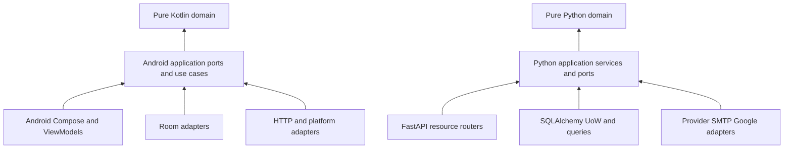
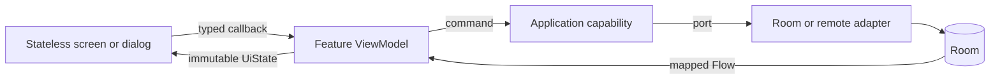
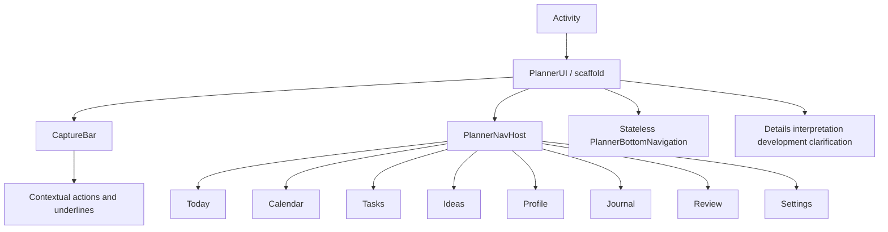
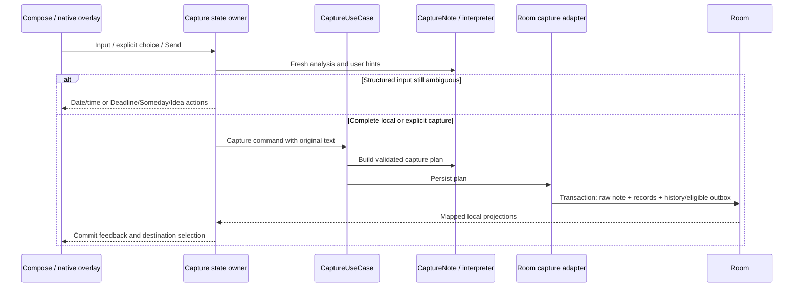
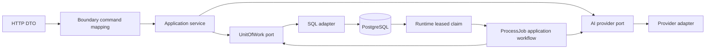
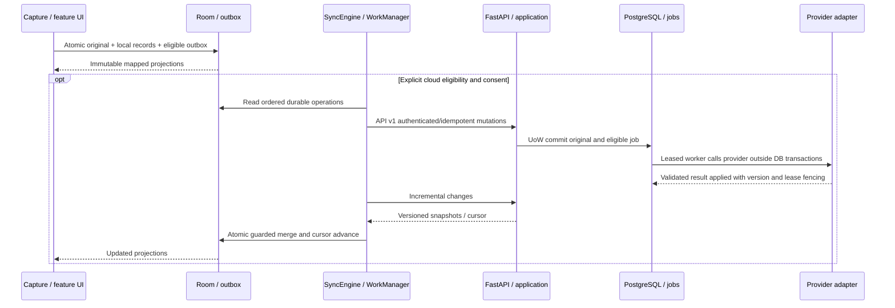

# Architecture

Last reviewed: **2026-10-29**. This describes the migration implementation. Current acceptance results and unresolved work are recorded in [Architecture migration](ARCHITECTURE_MIGRATION.md) and [Testing](TESTING.md). Product intent remains in [Concept](CONCEPT.md).

## Four logical layers in two monoliths

Android remains one Gradle app; backend remains one Python service with a separate durable worker. No new deployment services or speculative Gradle modules were introduced.

These arrows are **source dependencies**. Runtime calls from an application port to its configured adapter go in the other direction. Hilt infrastructure/di/AppModule and Python bootstrap/main are composition roots.

## Android source map

| Layer | Sources and responsibility |
| --- | --- |
| Domain | `domain/model`, `domain/policy`, `domain/interpretation`, `domain/time`: framework-free values and policies. Record remains a registry-driven task/event/idea/information value; no duplicate kind-specific persistence models were invented. |
| Application | `application/port`, `application/model`, `application/usecase`: query/command/external ports, plain results, shared capture and development approval. No pass-through use case or repository per base kind. |
| Infrastructure | `infrastructure/database/{dao,entity,mapper}`, `repository`, `remote`, `sync`, `preferences`, `security`, `serialization`: storage, transport and platform implementations. |
| Presentation | `presentation/{capture,today,calendar,tasks,ideas,profile,journal,review,settings,record,interpretation,development}`: each feature owns Route/Screen/ViewModel/UiState and its local components. `presentation/common`, `design`, `navigation`, `shell` are explicitly shared. |
| Native platform adapter | `infrastructure/overlay`: real service/windows/notification. `presentation/settings/platform/OverlaySettingsRoute.kt` binds permissions/lifecycle to controls through a narrow documented native boundary. |
| Composition | `MainActivity`, `PlannerApp`, `infrastructure/di/AppModule.kt`; root package contains only the two Android entry points. |

Complete source tree, port inventory and feature extension rules: [Android packages](ANDROID_PACKAGES.md). The previous flat features/core/data/sync arrangement is removed. Models, ports, state and components are actual separate packages/files; the dependency checker verifies package/directory consistency and ownership.

Storage objects are in `infrastructure/database/entity`; explicit conversions in `infrastructure/database/mapper/DatabaseMappers.kt`; SQL in `database/dao/StorageDao.kt`. `PlannerDatabase` stays the schema owner, while the mapped `PlannerDao` is infrastructure-only. Obsolete core model/time aliases are removed; tests and callers use canonical types.

**Room remains v4** with migrations 1→2→3→4 and exported schema. Table/column/index names and the SQLite contract are retained. Moving annotations is not a new schema migration, reset or downgrade.

## Feature MVVM and UI components

Each organizer destination has a feature ViewModel and immutable UiState: Today, Calendar, Tasks, Ideas, Profile, Journal, Review and Settings. Capture, details, manual interpretation and development have their own state owners. PlannerViewModel is the activity shell, not an owner of every screen's data. Each feature Route obtains its ViewModel with Hilt's Compose factory; the central graph only registers destinations and passes navigation callbacks. Stable route constants live in `presentation/navigation/PlannerRoutes.kt`; screen content receives `ScreenNavigation` callbacks, never a NavController. Controllers remain in route/composition bindings.

Mutable flows are private/protected; screen content receives state and callbacks. There is no public repository/preferences/sync object and no arbitrary vm.action business lambda. Loading/error/empty states and local retry are owned by the feature. Journal child records and week counters are loaded outside Compose. Native pickers and browser/document launchers remain UI concerns.

WorkspaceSelection coordinates presentation date/filter/search/page choices. The shell persists these through SavedStateHandle and refreshes device day/timezone. It does not cache business records. UiFeedback publishes the message and undo target together; dismissing an old snackbar cannot erase a newer undo action. Manual interpretation guards duplicate submission synchronously and retains the note on failure. Modal openings have generation-scoped state: cached forms and completion signals cannot close or populate a new session. Loading and retry stay in the modal; save failures remain inline. Saved editor drafts retain their original expected record version across Activity recreation, so reloading a newer snapshot cannot authorize stale form data.

Stable route strings remain today/calendar/tasks/ideas/profile/journal/triage/settings. `triage` still represents Review. Lists retain their existing bounds, stable IDs, privacy semantics and dates. Design tokens/fonts/illustrations are reused.

## Capture and correction flow

Private default Send applies a complete local proposal. Private notes create no outbox/provider request. Original-only and native overlay capture remain raw. Cloud automatic capture queues original text for provider interpretation. Explicit hints remain versioned and independent of original text. Pending submission resumes after clarification and user edits invalidate stale preview work.

CaptureUseCase is shared by the main composer and overlay. CaptureStore owns atomic persistence and post-commit scheduling. ApproveDevelopment owns current-result/version/allowed-step policy through a transactional port; its Room adapter retains the approved-job marker and creates linked tasks atomically. Sync no longer owns approval policy.

Corrections retain optimistic version checks, confirmation guards, original text and local/cloud provenance. Parent-first outbox ordering, serialized sync, bounded rotating deferred snapshots and atomic feed-cursor merging remain. Network responses never become a separate UI source of truth. WorkManager constructs SyncWorker through a Hilt-injected PlannerWorkerFactory with an explicit SyncEngine constructor parameter. PlannerApp supplies Configuration.Provider; the manifest removes only WorkManager's default initializer metadata. Production workers do not look services up through Hilt entry points.

## Backend source map and execution

| Layer | Sources and responsibility |
| --- | --- |
| Domain | `app/domain/entities.py`, `contracts.py`, `records.py`, `validation.py`, `capture_preview.py`, `time.py`: plain snapshots, invariants and temporal evidence policies; no FastAPI/Pydantic/SQLAlchemy/httpx imports |
| Application | `app/application/organizer.py`, `accounts.py`, `device_identity.py`, `dataset.py`, `process_job.py`, `mutations.py`, `ai_context.py`, `values.py`, `ports.py`: commands, ownership/version/idempotency policies, provider orchestration and transaction boundaries |
| Infrastructure | `app/infrastructure/persistence/unit_of_work.py`, provider/security gateways; existing `persistence`, `ai/provider.py`, `security`, quota/learning/operations modules: SQL, crypto, mail, Google, wire validation and observation persistence |
| Interface | `app/api`: FastAPI DTOs, dependency binding, request/form parsing and response/error translation; API workflows use plain commands mapped at the boundary |
| Runtime/composition | `app/bootstrap.py`, `main.py`, `jobs/worker.py`: wiring, ASGI runtime and worker claim/heartbeat/loop lifecycle |

Untrusted HTTP/provider JSON is validated by the existing strict Pydantic contracts. Application values are plain dataclasses; record invariants also validate internally assembled task actions. ORM objects are mapped to plain snapshots; the UoW tracks changes and generated feed sequences without overwriting database-assigned keys. Repository methods retain bounded queries and SQL locking. UoW commit/rollback is explicit in application workflows.

The worker runtime retains SKIP LOCKED claims, lease tokens, attempt accounting, concurrency limits and heartbeat. ProcessJob performs context assembly, external provider calls and deterministic application. Provider I/O occurs after the input UoW closes and before opening the result UoW. Both success and failure lock owner before re-reading/locking the current job and checking its lease. Stale inputs, confirmed corrections and obsolete leases remain protected.

Strict provider schema negotiation, refusal/bounds/fallback rules, temporal grounding, approved rules and replaceable provider integration are retained. Observation recording remains owner-scoped and atomic with accepted business changes. Contribution consent remains separate and off by default. No training is triggered.

## Compatibility and remaining boundaries

Logical layers do not require renaming every manifest/CLI/import path. Backend `app/services.py`, `app/ai/context.py` and provider/security import paths remain documented compatibility surfaces. Android has canonical physical packages; the worker factory accepts the legacy persisted worker name. They are not application dependencies. Legacy SQL helper implementations are isolated under infrastructure for operator/learning integrations; current HTTP and worker application workflows do not use them as business services.

Readiness/database probes are composed in main; existing deployment/configuration behavior is retained. Native overlay permission/lifecycle and activity-result I/O remain platform adapters. JSON form formatting in UI is distinct from domain record/temporal invariants. Package checks enforce inward imports and reject direct DAO/service access from screen/ViewModel code. They complement behavioral tests, not prove all semantic layering properties.

[Migration record](ARCHITECTURE_MIGRATION.md) owns actual verification, implementation compromises and unfinished acceptance. No source-file move alone proves lower CPU use, ANR resolution, production readiness or provider accuracy.

## Historical review references

The pre-migration MVVM/overlay review is superseded by the implementation above. Its findings, original evidence and regression scope are retained in [Testing](TESTING.md), ADR-025 and [Architecture migration](ARCHITECTURE_MIGRATION.md). Native overlay remains a platform adapter, with capture through the shared application use case.

## End-to-end capture and synchronization

## Extending a feature

| Layer | Public boundary and example | Allowed imports | Forbidden dependencies |
| --- | --- | --- | --- |
| Domain | Kotlin CaptureNote / Python record invariants | Standard language values and domain policies | Android/Room, FastAPI/Pydantic, SQL, network clients |
| Application | CaptureUseCase / ApproveDevelopment; OrganizerService / ProcessJob | Domain, meaningful capability/query/UoW ports | Concrete persistence, platform UI, HTTP frameworks/provider SDKs |
| Infrastructure | RoomOrganizerQueries / mapped DAO; SQLAlchemyUnitOfWork / ProviderAdapter | Domain/application and implementation libraries | Owning screen state or introducing alternative business policies |
| Presentation/interface | TasksViewModel + TasksScreen; resource routers + mapping | Application values/ports; UI or transport validation libraries | Direct DAO/repository/SQL access and business workflows |
| Composition/runtime | AppModule / PlannerApp; bootstrap / worker runtime | Ports and implementations needed for wiring | Duplicated capture/approval/interpretation policies |

For an Android feature, first reuse a domain policy and bounded application port; add a use case only when it owns a workflow. Implement atomic storage/outbox behavior in its adapter. Add immutable feature UiState and ViewModel methods, then stateless content with typed callbacks. Register routes centrally and reuse design-system components. Both capture surfaces call CaptureUseCase rather than duplicating its policy.

For a backend feature, validate wire data at the API edge and map it into plain application values. Put ownership, transaction and idempotency decisions in the application workflow; add a bounded UoW query or external port when necessary. Implement SQL/provider details in infrastructure and bind in bootstrap. Keep provider I/O outside transactions. Test policy with fake ports and persistence/lease behavior with real database regressions; run the architecture checker and update owning docs.

## Physical package organization — 2026-10-29

Logical boundary checks on October 28 did not enforce feature ownership, leaving too many files in one features package. ADR-026 closes that organizational gap. TodayScreen now composes Tomorrow, Schedule, Anytime, IdeaOfDay and DoneToday LazyListScope sections, preserving keys and lifted expansion state. Design components have individual files. Other screens retain feature-local components where they own actual reusable UI.

Room schema exports move to the new PlannerDatabase qualified-name directory; schema versions, SQL identities, database name and migrations are unchanged. Existing WorkManager specs may name app.planner.sync.SyncWorker: the new factory maps both old and new names to the injected implementation. New specs use infrastructure.sync.SyncWorker; unique-work names/backoff/network constraints stay unchanged. The nonexported overlay component is updated in the manifest; Activity/deep-link identity, DataStore keys and notification channels remain stable.
