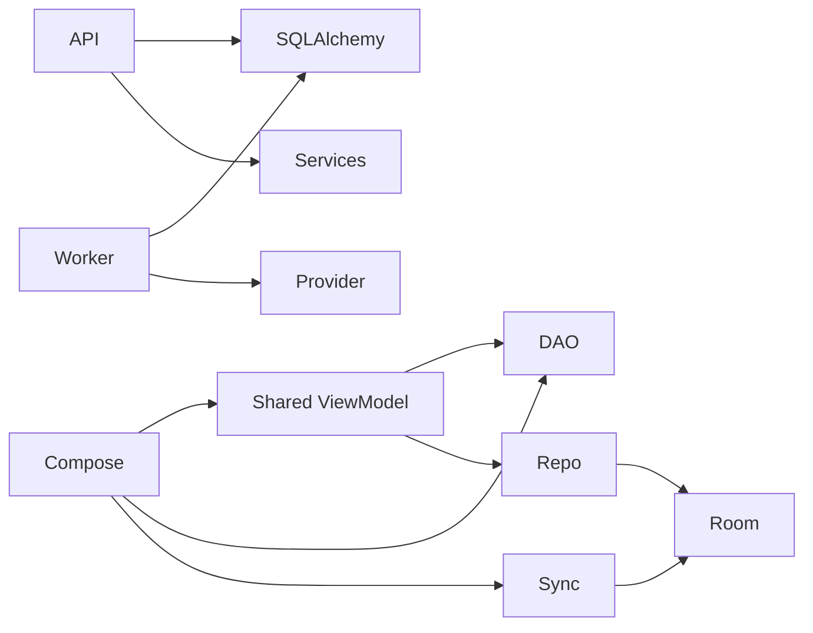

# Architecture migration — 2026-10-28

## Scope and baseline

Structural migration of Android and backend; existing raw notes, explicit corrections, privacy, outbox ordering, worker leases, API v1 and Room v4 are compatibility requirements. The supplied brief mentions v3; the actual starting schema is **v4** and must not be downgraded.

Before implementation: Android uses one activity-scoped PlannerViewModel, public mutable flows, direct DAO/service calls from Compose, Room-annotated business models, and a sync service also applying idea approval. Backend routers mix HTTP, SQL queries and transactions; services depend on HTTP exceptions and Pydantic transport schemas; the worker combines leases, orchestration and persistence.

## Execution record

- Initial Android baseline: combined debug/unit/lint/release command; debug/unit/debug-lint succeeded, release analysis ended in an internal lint exception. Source changed before the combined command finished, so this is not a clean complete untouched baseline.
- Backend baseline: **172 passed**, including the local PostgreSQL regressions.
- Phase 1: separate immutable domain models from Room storage objects, retaining SQL schema and explicit bidirectional mappings — verified by repository and API 37 acceptance.
- Phase 2: Android application ports/use cases and feature MVVM state — verified by 43 JVM tests, feature/route and editor device checks.
- Phase 3: backend domain/application/infrastructure/API boundaries — implemented; final 179-test suite and Docker readiness pass.
- Phase 4: local integration, boundary checks and documentation — complete. Git history records delivery to main.

Only executed checks can upgrade these statuses. Earlier feature verification in Testing remains historical evidence, not migration acceptance.

## Migration verification and observed failures

- Android app/debug test APK and original 36 unit tests passed after state/component extraction. First device attempt revealed missing Hilt navigation factories and was stopped after recording the crash; this is a failed runtime check, not acceptance. Destination creation now uses the Hilt Compose factory.
- New fake-port tests cover duplicate manual Save, retained input/retry, shared raw capture policy, incomplete event rejection, stale development approval and atomic snackbar undo. These passed in the 43-test Android JVM suite; both modal-session device regressions pass on the final source.
- Organizer API/worker focused suite: 38 passed after application/UoW extraction. Accounts and learning: 31 passed after account workflow extraction.
- Full backend migration attempt: 171 passed; repeat Alembic subprocess startup failed with Windows `Bad file descriptor: pyproject.toml`. That same migration test passed on isolated retry. Subsequent complete PostgreSQL-enabled reruns passed; the final backend suite is **179 passed**, 0 skipped, 61.78 seconds, with one existing Starlette/httpx deprecation warning.
- New pure workflow/UoW/import checks: five passed. Includes generated feed sequence preservation across SQLAlchemy autoflush and rollback-isolated JSON snapshots.
- A subsequent Kotlin incremental build failed internally on a `SettingsViewModel.clear` method reference colliding with lifecycle's internal clear symbol. The command is renamed clearLocalData; full debug/release/test/lint recompilation subsequently passed. No toolchain downgrade or global check suppression was applied.

## Contracts and remaining acceptance

Room stays v4; database/table/index and API v1 contracts are retained. Legacy import/manifest paths are listed in Dependencies. The current implementation is described in Architecture. Debug/release/lint/unit/device/PostgreSQL/Docker acceptance and source/doc/secret review pass within the scope below. Historical live-provider scores remain historical; this refactor does not start paid inference or training. Physical/OEM devices, live SMTP/Google, deployment, representative performance/accessibility and public launch gates remain open.

## Compatibility fixes found during verification

The extracted SQLAlchemy UoW initially risked copying an unset feed sequence over an autoflush-generated value. It now tracks original fields and reflects generated keys; regressions cover sequence retention and rollback-isolated JSON. Plain application commands preserve evaluated defaults and recursively mirror wire field-presence metadata, so old nested idempotency digests match exactly. These fixes retain transport defaults rather than changing API v1.

Navigation now uses constructor-aware Hilt factories. SyncWorker also receives its engine through a configured WorkerFactory rather than runtime entry-point lookup. A first device fixture assumed a constrained background job would finish immediately; Android kept it enqueued awaiting validated connectivity. Diagnostics showed earlier real workers succeeded. The final factory regression schedules a separate unconstrained private/no-endpoint job and asserts its terminal result; it does not relax production network constraints.

Modal sessions reset close signals and block stale cached snapshots until the current record loads. Editor drafts save their expected record version independently of a reloaded snapshot, protecting concurrent edits across Activity recreation. Query and save failures appear inside the modal with retry or correction controls.

Legacy UI-test adaptation: the expanded 22-scenario run passed all 13 capture cases and four organizer cases, but five older organizer tests failed on former raw-default behavior, fixed-time snackbar waiting, an offscreen/duplicate title selector and actions before modal close. The raw-persistence/consent cases now choose Original note only explicitly; completion dismisses the actual snackbar, restored-task checks use UUID tags, and test setup clears only transient draft/feedback state. Saved-data assertions are retained. The final organizer rerun passed 11/11; these failures are not counted as passes.

Remaining architectural compromises are intentional: there is one Gradle module and one Python monolith; manifest/CLI compatibility paths remain. Existing string-backed preference keys and dynamic JSON fields/job projections remain at application/presentation adapter boundaries. They do not introduce framework dependencies into Domain/Application. Package checks enforce imports and selected UI rules; they are not a proof of every semantic layering property.

## Final local acceptance — completed 2026-10-29

- Backend: **179 passed**, 0 skipped, with real PostgreSQL regressions; one existing Starlette/httpx deprecation warning.
- Android: **43 JVM tests passed**; debug/test/release APK builds passed; final lint **0 errors / 9 warnings**. Release remains unsigned.
- API 37: **26 distinct passing scenarios** across 13 capture cases, 11 organizer/editor cases, one eight-route/native-overlay/worker fixture and one real-HTTP manual sync case. Earlier failed attempts above are retained; corrected checks retain raw-data, exact-UUID, privacy and version assertions.
- Docker: API/worker rebuilt with the existing PostgreSQL volume; health/readiness pass, runtime UID 10001, migration head f26a81d705bc. Room stays v4; no reset or destructive migration.
- Architecture imports, documentation links/fragments/images/reference hashes, staged whitespace and exact-key secret scan pass. CI enforces the source rules. The final organizer/lint runs spanned an overnight host pause; their reported wall duration is not a performance measurement.
- Full [verification record](assets/benchmarks/2026-10-28-architecture-verification.json), [local benchmark](assets/benchmarks/2026-10-28-architecture-local.json), commands and incidents in [Testing](TESTING.md).

This completes the local architecture/refinement scope. Physical/OEM devices, real SMTP/Google, public deployment/signing, representative performance/TalkBack and broader model-quality acceptance remain open. The refactor does not certify those gates or claim an ANR/CPU fix.

## 2026-10-29 physical source organization follow-up

The October 28 increment established logical ports/state boundaries but left too many unrelated files in features. Its scoped acceptance did not verify package ownership. The user requested the physical hierarchy now documented in [Android packages](ANDROID_PACKAGES.md). This follow-up removes features/core/data/sync root packages, groups infrastructure by adapter responsibility, separates application port/usecase/model and gives every presentation feature a Route/Screen/ViewModel/UiState home. Today has real visual sections; navigation does not instantiate feature ViewModels.

The Room class package/export directory moves, but all historical schema identities and SQL contracts are retained. WorkManager's stored old class name is mapped and has passed a real enqueue/execute regression. Native overlay moves with its nonexported manifest component; Activity, IDs, preference/credential/channel/work keys stay stable. Current focused/final results are owned by the October 29 section of Testing; earlier results above remain historical.

Physical follow-up acceptance: **187 backend / 43 JVM / 25 distinct API 37 scenarios passed**. Debug/test/unsigned-release builds and final lint pass. All historical Room schema JSON contents are unchanged. The old persisted worker name was executed successfully, not just string-matched. Earlier runtime/lint failures and repaired test synchronization are preserved in Testing. Main-device update was skipped because that emulator was unavailable. [Verification report](assets/benchmarks/2026-10-29-android-packages.json).
