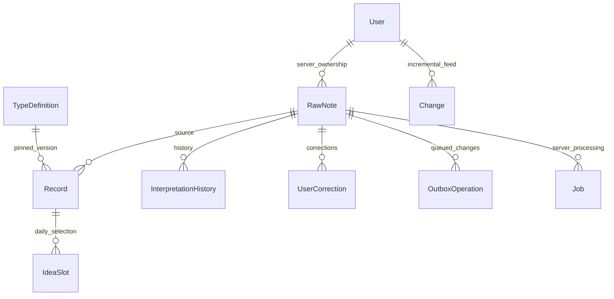
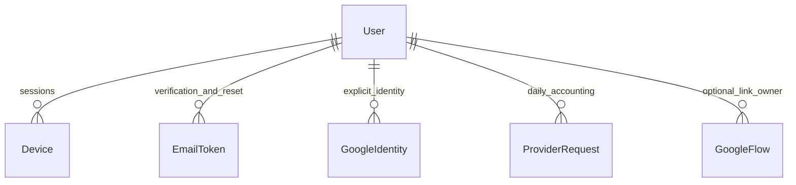
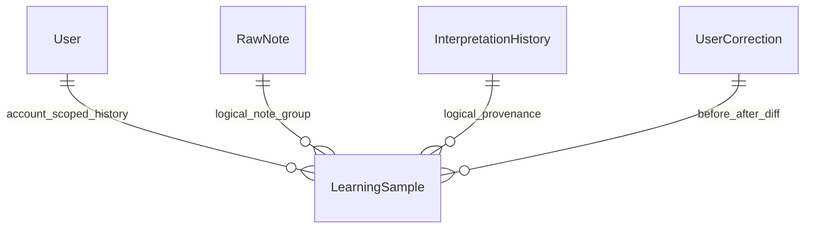

# Data model

Last reviewed: **2026-10-28**. These are actual schemas; intended product semantics are in [Concept](CONCEPT.md). [API](API.md) owns wire contracts.

## Current Room implementation

[Room entities](../android/app/src/main/java/app/planner/core/database/entities/Entities.kt) define nine persisted entities. [Domain models](../android/app/src/main/java/app/planner/domain/model/Models.kt) are separate framework-free values with [explicit mappings](../android/app/src/main/java/app/planner/core/database/Mappers.kt). [Storage DAO](../android/app/src/main/java/app/planner/core/database/PlannerDatabase.kt) owns SQL queries and the schema is **version 4**. Android keeps one dataset per installation; a global owner UUID in Meta scopes that dataset. It does not accept arbitrary per-row client user IDs. Connecting another owner requires explicit export/clear.

| Entity/table | Stored responsibility |
| --- | --- |
| RawNote / notes | UUID; content and independent originalContent; creation/update instants; APP/OVERLAY source; LOCAL_ONLY/CLOUD_ALLOWED privacy; processing/sync statuses; raw revision, locale, timezone, manual flag |
| Record / records | UUID/sourceNoteId; task/event/idea/information; custom type UUID + pinned schema version; title and fieldsJson; separate temporal fields; pending/completed/archived; completion time, pin, idea deferral; creation/update, interpretationVersion, isUserConfirmed, record version |
| InterpretationHistory / interpretations | UUID/note/input/schema/model versions; proposed JSON with validation/risk metadata; valid/review/stale result; corrected flag; creation time |
| UserCorrection / corrections | UUID/source note; before/after interpretation JSON; timestamp |
| TypeDefinition / types | Composite UUID/schemaVersion key; name/base kind, field definitions, display configuration, allowed capabilities, enabled |
| UserRule / rules | UUID, description, conditions/action JSON, enabled, explicitlyApproved |
| OutboxOperation / outbox | Stable UUID, entity/note dependency IDs, method/path/immutable payload; retry count, next-attempt epoch milliseconds, safe error, queued/failed/conflict status, monotonic ordering time |
| IdeaSlot / idea_slots | Local calendar day primary key and selected record UUID |
| Meta / meta | Owner, incremental cursor, connection/provider status, timings, daily note/task triage slots/seen/snooze values, individual development results and approval markers |

Room relationships are enforced by repository transactions and source IDs; foreign keys are not declared on these local entities. PostgreSQL uses foreign keys. Do not add destructive deletion or change provenance without a migration and both-side integrity tests.

Private automatic main-composer capture uses the existing history table with modelVersion=local-rules-v1 and schemaVersion=1. Original note, all resolved records and the local proposal commit atomically; machine-derived records are initially unconfirmed and remain editable. Private data has no outbox operation. Explicit original-only captures have no records. For a task with an explicit deadline day and clock, deterministic application stores dueAt and clears scheduled startAt/dueDate; it does not turn the deadline into an appointment. No Room migration is needed; schema remains v4.

Tentative local preview records may carry kindChoices as optional metadata; they cannot be automatically persisted until resolved. A selected Task + deadline is an explicitly confirmed manual task with dueDate, no plannedFor/startAt; Someday is a confirmed undated task; Idea is a confirmed idea. Deadline/type selection is transient ViewModel state until capture, and raw text editing clears the selected deadline. Existing raw text, record fields and temporal hint schema are unchanged. Original proposal history is retained by automatic local capture; manual-choice capture retains original text and final explicit record, without collecting a per-keystroke draft timeline.

## Relationships

The User/Job/Change relationships are backend-only; the others also describe logical local relationships.

## Temporal semantics

2026-10-21 increment (**implemented; repository tests passed**): Tasks has paginated Today (including earlier unresolved execution days), Upcoming, Someday, All, Completed and Archived queries. Execution date takes priority over a deadline for these discovery buckets; deadlines remain separately displayed. Today focus predicates are unchanged. Old unresolved tasks return in at most three stable daily slots, stored in Meta (`task-review:DAY`, `task-seen:ID`, `task-snooze:ID`); Later snoozes review for seven days without changing a deadline. Idea candidates sort by least-recently shown slot date, then creation/UUID. Conversion creates a new raw note/task with `fields.developedFrom`; splitting uses `fields.splitFrom`. No entity columns change: Room stays v3, prior migrations remain registered.

- Instants: startAt, endAt, dueAt, remindAt, completedAt and creation/update fields use fixed millisecond UTC ISO strings, e.g. 2026-10-15T13:30:00.000Z. Offset inputs normalize before storage; fixed width supports indexed lexical comparisons.
- Days: plannedFor is execution date; dueDate is a date-only deadline; deferredUntil is idea eligibility. These use YYYY-MM-DD. dueDate and dueAt are mutually exclusive.
- timezone preserves IANA capture/record context. Display and daily queries use the current device timezone; backend relative dates resolve against capture time in the note's timezone.
- A local day spans local midnight to next midnight, converted to UTC. DST can produce 23/25-hour days. Native picker rejects nonexistent times and asks which occurrence for repeated times.
- Today includes pending records with starts in the day or ongoing spans crossing its start; pending tasks also qualify by plannedFor/dueDate or dueAt within the day. Schedule membership is evaluated separately, preventing a deadline from becoming a meeting. Untimed qualifying tasks appear in Anytime. Overdue-only tasks are not automatically added.
- Record start/end never imply an invented duration. A deadline does not create an external calendar event.
- Completion sets a separate instant and state; undo clears it. Done Today filters by completion instant, rather than planned date.
- Idea selection persists the least recently shown eligible idea, using MAX(day) from previous slots, then creation/UUID as deterministic tie-breakers. Unseen ideas sort first. No empty slot is written before an idea exists. Later defers until tomorrow and retains today's selected slot, so another idea does not replace it.
- Reminder timestamps and recurrence strings are retained data only. Alarm delivery and occurrence expansion are not implemented.

Exact predicates: [DayPolicy](../android/app/src/main/java/app/planner/domain/DayPolicy.kt), [DAO](../android/app/src/main/java/app/planner/core/database/PlannerDatabase.kt).

## Local preferences and discovery

DataStore adds `cloudConsent=cloud-notes-v1`, `privateCapture`, `appearance` (system/light/dark) and `weekStart` (sunday/monday). Missing, unknown or legacy consent fails closed to private. These do not alter existing raw-note privacy flags or queued operations. Clear local data also clears consent and returns capture to private.

Tasks filters page 50 rows with stable pin/date/creation/UUID ordering. All unfinished tasks remain reachable independent of Today’s 200-row day limit. Completed/archived views use the same records table. Ideas search title/details through a bound SQL LIKE query with 50-row paging; LIKE is ASCII case-insensitive and preserves SQLite’s case-sensitive behavior for non-ASCII characters. Conversion does not remove the source idea from this query. Linked tasks default to private; UI passes the consent-gated current capture choice, and an original private note can never be escalated to cloud by conversion/splitting. Profile metrics are SQL aggregates; collections join each record’s pinned type version.

## Integrity and versioning requirements

OriginalContent remains independent of content and records. Server raw-content PATCH increments note version while retaining the first capture. Android currently exposes interpretation editing, not raw-content replacement. One note may have several records; automated IDs are deterministic UUIDv5(note ID, proposal position). Re-extraction archives superseded unconfirmed records instead of losing change history.

Raw version identifies extraction input; interpretationVersion records that input; schemaVersion versions the extraction envelope; typeSchemaVersion binds a record to a retained type definition; record version governs optimistic edits. These are different counters.

Local edits atomically update records, increment revision, mark confirmed, and store corrections/outbox work. A stale editor is rejected while retaining its form. Pending local changes suppress conflicting remote merges; confirmed corrections reject new unconfirmed AI records for the same note. Backend user_corrected/input/record-version checks retain stale history without applying it.

Type PATCH appends a definition version; existing record bindings remain unchanged. Generic primitives: text, number, date, datetime, duration, boolean, enum, URL, reference UUID, and quantity with unit. Android uses native date/time controls and primitive editors; unchanged unknown JSON fields preserve their original type. Core views remain dedicated layouts. No type-supplied executable code runs.

## Backend schema

[SQLAlchemy models](../backend/app/persistence/models.py) define users, invitations, devices, notes, records, interpretations, corrections, types, rules, jobs, changes, operations. All business rows carry authorized ownership. Invitations/device credentials store hashes, expiry and used/revoked state.

Server notes additionally keep received_at for ingestion rate limits, independent of client capture time. Record core fields have indexed columns plus validated structured JSON. Jobs persist note/input/kind/idea revision, attempts, retry time, lease/token, result and safe error. Changes have an increasing sequence, owner, kind/entity and payload. Operations retain owner + idempotency UUID, canonical payload digest, and committed response.

Development jobs identify the exact idea revision and retain old results. Extraction queue reuse uses the note/input version; explicit reprocess can requeue a terminal job. Archived records stay in the incremental feed.

## Indices and migrations

Room indices cover note creation/processing, source-note lookup, kind/state/planned day, starts/deadlines/completion, and outbox status/retry, entity, ordering, entity-order, note/path dependencies.

| Upgrade | Change / preservation |
| --- | --- |
| Room 1→2 | Normalize queryable instants with SQLite strftime; preserve original text, records and outbox |
| Room 2→3 | Add three ordered/dependency outbox indices; no row replacement |
| Room 3→4 | Add notes.interpretationHintsJson with default {}; reset incoming cursor to 0 for safe replay of historical feed gaps; preserve notes, records and outbox |
| Alembic a15a67f338ba | Frozen initial backend tables/indices |
| Alembic b72c114e390a | Development-job unique identity includes record revision; historical results remain |
| Alembic c81fa728ac09 | Add/index server ingestion time; historical rows backfill their previous capture time |
| Alembic d93b8e401f72 | Note clarification JSON and persistent per-owner provider request accounting |
| Alembic e04c9f512a83 | Public account credentials, verification/reset tokens, Google flows/identities, auth rate counters and worker heartbeats |
| Alembic f26a81d705bc | Owner-scoped learning_samples journal; user contribution consent/time and operator-only synthetic provenance flag; existing users default off |

Exports: [Room schema v4](../android/app/schemas/app.planner.core.database.PlannerDatabase/4.json). Upgrade code: [Room migrations](../android/app/src/main/java/app/planner/core/database/Migrations.kt), [Alembic revisions](../backend/alembic/versions/a15a67f338ba_initial.py). Normal upgrades never use destructive resets. The development-job downgrade deliberately refuses to discard revisions; restore a pre-upgrade backup instead. Executed migration results: [Testing](TESTING.md#executed-results).

## Clarifications, reconciliation and public accounts

RawNote now stores interpretationHintsJson separately from originalContent. Wire notes expose interpretationHints as an object with schemaVersion=1 and up to 24 clarifications. Each clarification identifies an exact UTF-16 start/end span and unchanged text, a date/time/datetime/literal kind and the corresponding selected values. Editing a draft invalidates its choices; server raw-content PATCH clears old hints. A date-only choice never supplies a clock time. Invalid or repeated DST local times remain unresolved. DataStore persists draft text and hints together; passwords are never persisted there.

Meta keys incoming:note:ID and incoming:record:ID retain the latest deferred remote snapshot. Incoming snapshots and feed cursor commit together, including while local operations block merging. Only reconciliation removes a deferred snapshot after successful application; an older acknowledgment must not erase a newer processing status at the same raw-note version. Reconciliation rotates through bounded 100-row pages using inboxScan so blocked rows do not starve later rows.

Backend User has normalized email, verified state and optional Argon2id password hash. Email verification/reset credentials and Google handoff credentials are hashed, expiring and single-use. Google identities bind issuer/subject to one owner; matching email alone does not link accounts. Google flows retain nonce, app PKCE challenge, expiry and optional linking owner. Rate counters contain keyed hashes, rather than raw email/IP identifiers. ProviderRequest accounts for actual managed calls per owner/UTC day. ServiceHeartbeat establishes worker liveness independently of provider requests.

Account deletion removes that owner's active server business/auth data after password and typed confirmation. Local notes are retained and new capture returns to private. Existing operator invitations remain supported. Backup retention is external to active-account deletion; operators must define retention and expiry before public launch.

Related: [Architecture](ARCHITECTURE.md), [API](API.md), [Decisions](DECISIONS.md).

## Passive dataset journal

LearningSample stores immutable event_key/group_key, owner (nullable only for synthetic data), origin, event kind, label source, schema version, timestamp and versioned JSON data. Input snapshots are independent of current RawNote/Record values. Predictions include model/prompt/schema provenance, bounded provider traces, validation status and actual record state after processing; corrections retain before/after, JSON-pointer diffs and interpretation links. User actions such as completion/undo are not semantic labels. Old input revisions that cannot be reconstructed are explicitly unavailable.

Only owner is a physical foreign key. Logical input/history IDs may outlive a disposable synthetic QA account; synthetic rows become ownerless before that account is deleted. Real account deletion erases its samples. Contribution consent defaults false and is checked at export time; it is independent of cloud capture consent. Room remains v4 and no private notes/drafts are uploaded. Full label semantics, API and retention/split caveats: [Dataset](DATASET.md).
