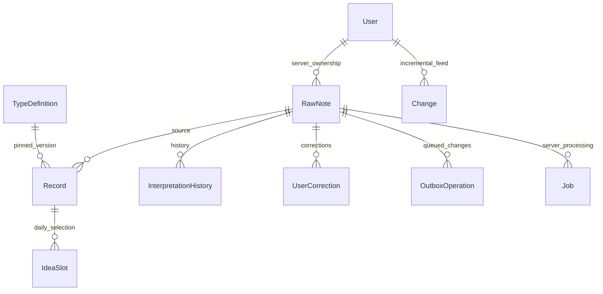

# Data model

Last reviewed: **2026-10-21**. These are actual schemas; intended product semantics are in [Concept](CONCEPT.md). [API](API.md) owns wire contracts.

## Current Room implementation

[Models.kt](../android/app/src/main/java/app/planner/core/model/Models.kt) defines nine persisted entities. [DAO](../android/app/src/main/java/app/planner/core/database/PlannerDatabase.kt) owns queries and the schema is **version 3**. Android keeps one dataset per installation; a global owner UUID in Meta scopes that dataset. It does not accept arbitrary per-row client user IDs. Connecting another owner requires explicit export/clear.

| Entity/table | Stored responsibility |
| --- | --- |
| RawNote / notes | UUID; content and independent originalContent; creation/update instants; APP/OVERLAY source; LOCAL_ONLY/CLOUD_ALLOWED privacy; processing/sync statuses; raw revision, locale, timezone, manual flag |
| Record / records | UUID/sourceNoteId; task/event/idea/information; custom type UUID + pinned schema version; title and fieldsJson; separate temporal fields; pending/completed/archived; completion time, pin, idea deferral; creation/update, interpretationVersion, isUserConfirmed, record version |
| InterpretationHistory / interpretations | UUID/note/input/schema/model versions; proposed JSON with validation/risk metadata; valid/review/stale result; corrected flag; creation time |
| UserCorrection / corrections | UUID/source note; before/after interpretation JSON; timestamp |
| TypeDefinition / types | Composite UUID/schemaVersion key; name/base kind, field definitions, display configuration, allowed capabilities, enabled |
| UserRule / rules | UUID, description, conditions/action JSON, enabled, explicitlyApproved |
| OutboxOperation / outbox | Stable UUID, entity/note dependency IDs, method/path/immutable payload; retry count, next-attempt epoch milliseconds, safe error, queued/failed/conflict status, monotonic ordering time |
| IdeaSlot / idea_slots | Local calendar day primary key and selected record UUID |
| Meta / meta | Owner, incremental cursor, connection/provider status, timings, daily note/task triage slots/seen/snooze values, individual development results and approval markers |

Room relationships are enforced by repository transactions and source IDs; foreign keys are not declared on these local entities. PostgreSQL uses foreign keys. Do not add destructive deletion or change provenance without a migration and both-side integrity tests.

## Relationships

The User/Job/Change relationships are backend-only; the others also describe logical local relationships.

## Temporal semantics

2026-10-21 increment (**implemented; repository tests passed**): Tasks has paginated Today (including earlier unresolved execution days), Upcoming, Someday, All, Completed and Archived queries. Execution date takes priority over a deadline for these discovery buckets; deadlines remain separately displayed. Today focus predicates are unchanged. Old unresolved tasks return in at most three stable daily slots, stored in Meta (`task-review:DAY`, `task-seen:ID`, `task-snooze:ID`); Later snoozes review for seven days without changing a deadline. Idea candidates sort by least-recently shown slot date, then creation/UUID. Conversion creates a new raw note/task with `fields.developedFrom`; splitting uses `fields.splitFrom`. No entity columns change: Room stays v3, prior migrations remain registered.

- Instants: startAt, endAt, dueAt, remindAt, completedAt and creation/update fields use fixed millisecond UTC ISO strings, e.g. 2026-10-15T13:30:00.000Z. Offset inputs normalize before storage; fixed width supports indexed lexical comparisons.
- Days: plannedFor is execution date; dueDate is a date-only deadline; deferredUntil is idea eligibility. These use YYYY-MM-DD. dueDate and dueAt are mutually exclusive.
- timezone preserves IANA capture/record context. Display and daily queries use the current device timezone; backend relative dates resolve against capture time in the note's timezone.
- A local day spans local midnight to next midnight, converted to UTC. DST can produce 23/25-hour days. Native picker rejects nonexistent times and asks which occurrence for repeated times.
- Today includes pending records with starts in the day or ongoing spans crossing its start; pending tasks also qualify by plannedFor/dueDate or dueAt within the day. Schedule membership is evaluated separately, preventing a deadline from becoming a meeting. Untimed qualifying tasks appear in Anytime. Overdue-only tasks are not automatically added.
- Record start/end never imply an invented duration. A deadline does not create an external calendar event.
- Completion sets a separate instant and state; undo clears it. Done Today filters by completion instant, rather than planned date.
- Idea selection persists the least recently shown eligible idea, using MAX(day) from previous slots, then creation/UUID as deterministic tie-breakers. Unseen ideas sort first. No empty slot is written before an idea exists. Later defers until tomorrow and retains today's selected slot, so another idea does not replace it.
- Reminder timestamps and recurrence strings are retained data only. Alarm delivery and occurrence expansion are not implemented.

Exact predicates: [DayPolicy](../android/app/src/main/java/app/planner/domain/DayPolicy.kt), [DAO](../android/app/src/main/java/app/planner/core/database/PlannerDatabase.kt).

## Local preferences and discovery

DataStore adds `cloudConsent=cloud-notes-v1`, `privateCapture`, `appearance` (system/light/dark) and `weekStart` (sunday/monday). Missing, unknown or legacy consent fails closed to private. These do not alter existing raw-note privacy flags or queued operations. Clear local data also clears consent and returns capture to private.

Tasks filters page 50 rows with stable pin/date/creation/UUID ordering. All unfinished tasks remain reachable independent of Today’s 200-row day limit. Completed/archived views use the same records table. Ideas search title/details through a bound SQL LIKE query with 50-row paging; LIKE is ASCII case-insensitive and preserves SQLite’s case-sensitive behavior for non-ASCII characters. Conversion does not remove the source idea from this query. Linked tasks default to private; UI passes the consent-gated current capture choice, and an original private note can never be escalated to cloud by conversion/splitting. Profile metrics are SQL aggregates; collections join each record’s pinned type version.

## Integrity and versioning requirements

OriginalContent remains independent of content and records. Server raw-content PATCH increments note version while retaining the first capture. Android currently exposes interpretation editing, not raw-content replacement. One note may have several records; automated IDs are deterministic UUIDv5(note ID, proposal position). Re-extraction archives superseded unconfirmed records instead of losing change history.

Raw version identifies extraction input; interpretationVersion records that input; schemaVersion versions the extraction envelope; typeSchemaVersion binds a record to a retained type definition; record version governs optimistic edits. These are different counters.

Local edits atomically update records, increment revision, mark confirmed, and store corrections/outbox work. A stale editor is rejected while retaining its form. Pending local changes suppress conflicting remote merges; confirmed corrections reject new unconfirmed AI records for the same note. Backend user_corrected/input/record-version checks retain stale history without applying it.

Type PATCH appends a definition version; existing record bindings remain unchanged. Generic primitives: text, number, date, datetime, duration, boolean, enum, URL, reference UUID, and quantity with unit. Android uses native date/time controls and primitive editors; unchanged unknown JSON fields preserve their original type. Core views remain dedicated layouts. No type-supplied executable code runs.

## Backend schema

[SQLAlchemy models](../backend/app/persistence/models.py) define users, invitations, devices, notes, records, interpretations, corrections, types, rules, jobs, changes, operations. All business rows carry authorized ownership. Invitations/device credentials store hashes, expiry and used/revoked state.

Server notes additionally keep received_at for ingestion rate limits, independent of client capture time. Record core fields have indexed columns plus validated structured JSON. Jobs persist note/input/kind/idea revision, attempts, retry time, lease/token, result and safe error. Changes have an increasing sequence, owner, kind/entity and payload. Operations retain owner + idempotency UUID, canonical payload digest, and committed response.

Development jobs identify the exact idea revision and retain old results. Extraction queue reuse uses the note/input version; explicit reprocess can requeue a terminal job. Archived records stay in the incremental feed.

## Indices and migrations

Room indices cover note creation/processing, source-note lookup, kind/state/planned day, starts/deadlines/completion, and outbox status/retry, entity, ordering, entity-order, note/path dependencies.

| Upgrade | Change / preservation |
| --- | --- |
| Room 1→2 | Normalize queryable instants with SQLite strftime; preserve original text, records and outbox |
| Room 2→3 | Add three ordered/dependency outbox indices; no row replacement |
| Alembic a15a67f338ba | Frozen initial backend tables/indices |
| Alembic b72c114e390a | Development-job unique identity includes record revision; historical results remain |
| Alembic c81fa728ac09 | Add/index server ingestion time; historical rows backfill their previous capture time |

Exports: [Room schema versions](../android/app/schemas/app.planner.core.database.PlannerDatabase/3.json). Upgrade code: [Room migrations](../android/app/src/main/java/app/planner/core/database/Migrations.kt), [Alembic revisions](../backend/alembic/versions/a15a67f338ba_initial.py). Normal upgrades never use destructive resets. The development-job downgrade deliberately refuses to discard revisions; restore a pre-upgrade backup instead. Executed migration results: [Testing](TESTING.md#executed-results).

Related: [Architecture](ARCHITECTURE.md), [API](API.md), [Decisions](DECISIONS.md).
