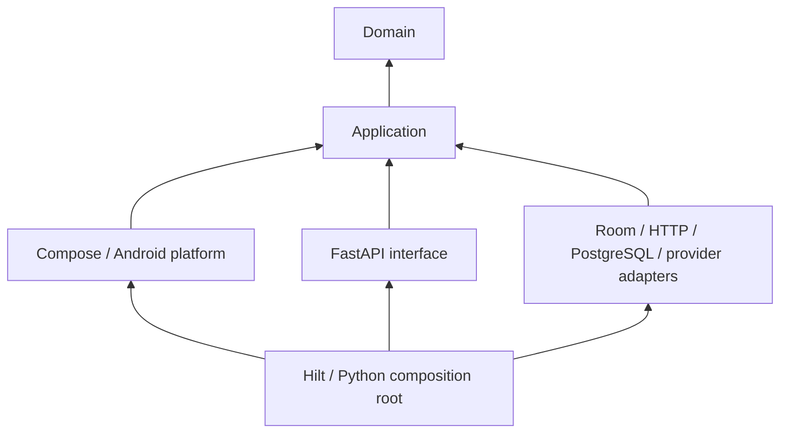

# Dependency rules

The migration target has four logical layers in each existing monolith. Keeping one Gradle app and one Python service avoids new deployment/build modules.

Arrows represent source imports, not runtime call order. Domain must contain only business models and policies. Application owns workflows and ports. Infrastructure implements persistence, provider and platform ports. Presentation owns formatting, native pickers and navigation, and invokes application commands through feature ViewModels. The migration record lists remaining exceptions until verification is complete.

## Enforced package mapping and exceptions

Run `uv run --project backend --frozen python tools/check_architecture.py`. CI and a backend test execute the same source checks. Android domain/application must not import framework/Room/HTTP/JSON adapters. Feature UI/ViewModels cannot import concrete repositories/DAO/preferences/sync or expose mutable flows. Python domain/application cannot import FastAPI/Pydantic/SQLAlchemy/httpx or concrete outer packages. API resource modules cannot query persistence or construct providers/security clients.

Android's existing `core/database`, `core/network`, `data`, `sync` are infrastructure; `core/designsystem` is presentation. `features/overlay` contains native Android platform adapters, explicitly excluded from the screen/ViewModel import rule; Compose overlay controls accept callbacks. `core/model` contains domain type aliases for source compatibility.

Backend retains provider/security/operator modules at historical paths, wired through bootstrap. `app/services.py` re-exports infrastructure compatibility helpers; `app/ai/context.py` adapts historical DB callers to application context assembly. New application services import neither. These paths are compatibility surfaces, not additional business layers.

`androidx.hilt:hilt-lifecycle-viewmodel-compose:1.4.0` supplies the DI-aware destination factory. Plain Navigation Compose `viewModel()` did not provide Hilt dependencies in the first runtime attempt. The package/API is documented in [AndroidX Hilt releases](https://developer.android.com/jetpack/androidx/releases/hilt). Existing build/framework pins remain otherwise unchanged.

WorkManager uses `sync/PlannerWorkerFactory.kt`, injected into `PlannerApp` (Configuration.Provider). SyncWorker receives SyncEngine in its constructor. Only the WorkManager default startup metadata is removed; other AndroidX startup initializers remain enabled. `SyncDependencies` is retained as an instrumentation/diagnostic compatibility entry point; production code does not call EntryPointAccessors. See [official custom WorkManager configuration](https://developer.android.com/develop/background-work/background-tasks/persistent/configuration/custom-configuration).

`navigation/PlannerRoutes.kt` owns route constants; `ScreenNavigation` exposes presentation callbacks. NavController is restricted to graph/route bindings. Record/interpretation/development modal sessions reject old close signals and publish inline failures. These are presentation lifecycle mechanics; version/CAS and approval rules remain in application/storage policies.
