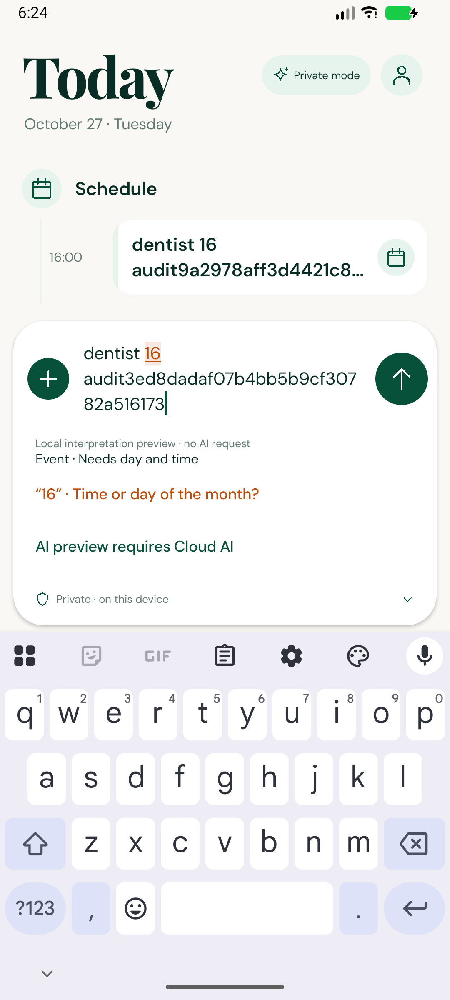
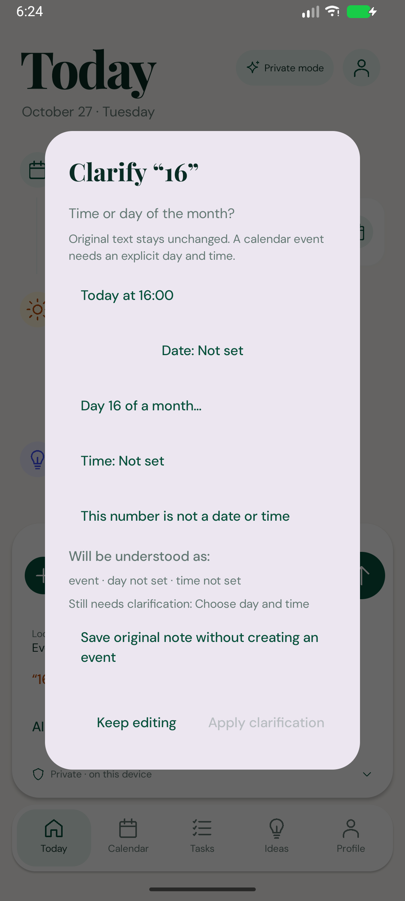
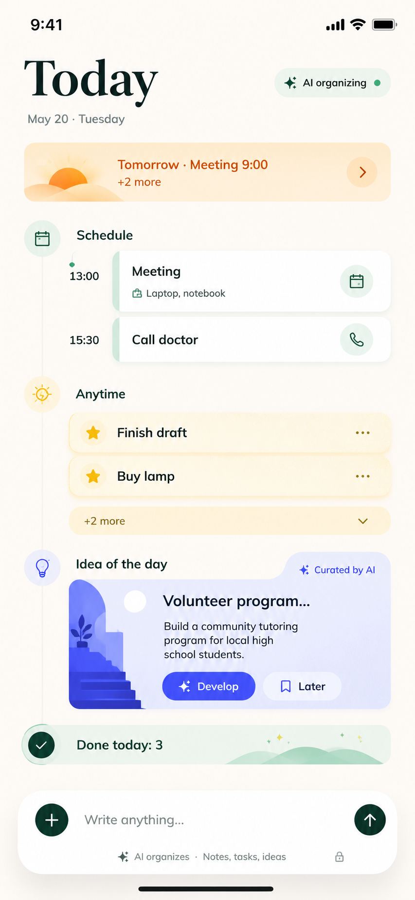
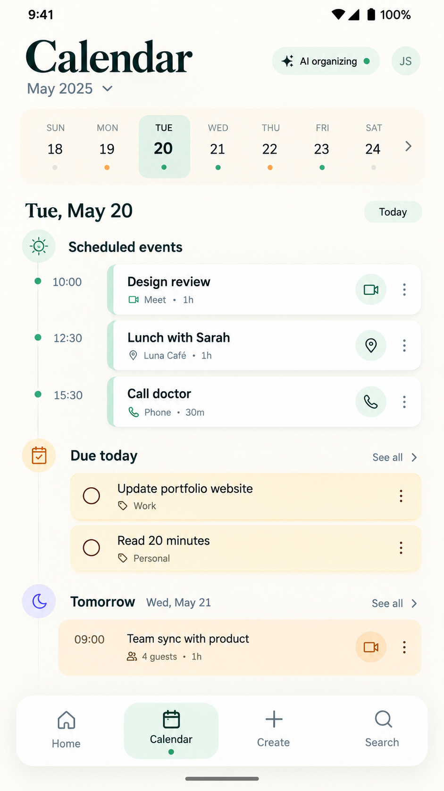
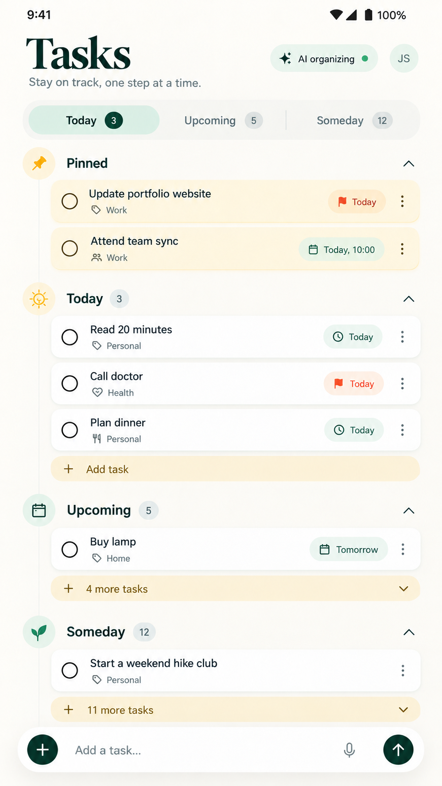
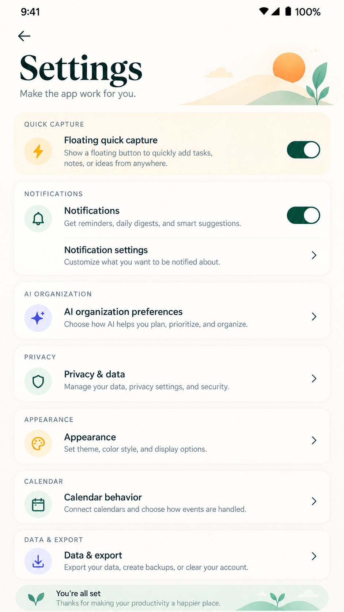
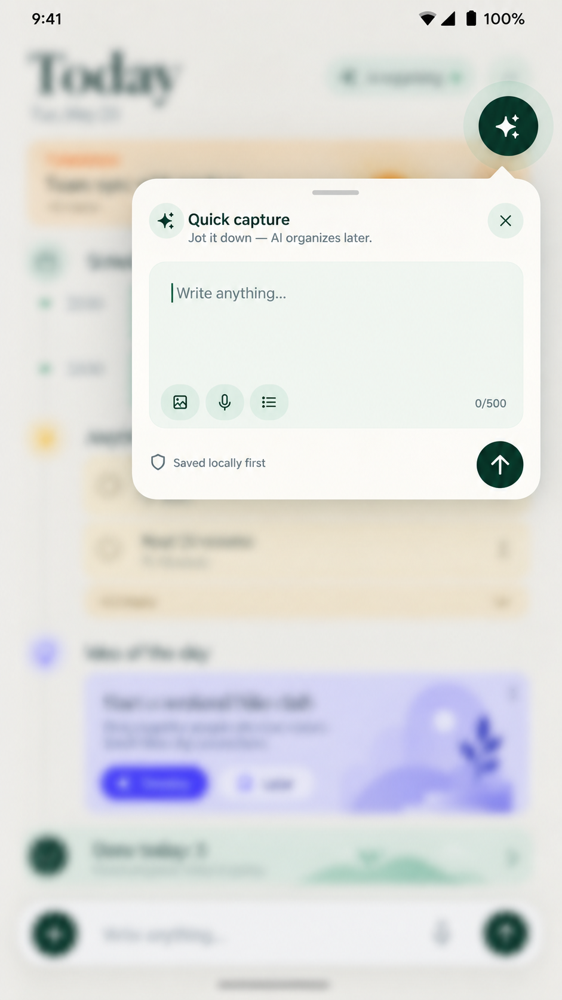

# Screens and UX

Last reviewed: **2026-10-28**. The supplied images are visual targets under [ADR-016](DECISIONS.md#adr-016-reference-led-ui-and-complete-task-discovery). Current emulator comparisons: [Visual audit](VISUAL_AUDIT.md). Historical captures remain separately labeled.

## Current navigation and interactions

[PlannerUI](../android/app/src/main/java/app/planner/presentation/shell/PlannerUI.kt) owns the persistent composer and consistent Today / Calendar / Tasks / Ideas / Profile navigation. Saved primary navigation entries restore useful route/list state. Profile links Journal, Review and Settings. Secondary headers have Back. Keyboard visibility hides primary navigation while keeping capture above IME/system insets. No chat, month grid or analytics view exists.

The plus menu chooses Automatic on device (Private) / Note for AI (Cloud), Original note only, Task for today, Task without a date, Idea, Event or Information. Choosing a type is optional. Default private Send now saves a complete local interpretation as records, preserving the original separately; a displayed preview is not merely discarded. Original note only deliberately saves no records. The private composer control says Private. Text saves after one Room transaction; raw input is independent of interpretation. Main/overlay inputs cap at 20,000 characters; in-flight saves prevent duplicate submission and retain newer typing. Drafts persist through DataStore. Local save confirmation never implies successful AI.

The composer shows Private by default. An empty Today includes a nonblocking first-use explanation of private Journal storage, manual capture and optional cloud interpretation. Choosing Cloud AI first explains server/provider transmission, relevant context, queued offline uploads, provider retention responsibility, and the ability to switch back. Consent does not upload existing private notes. Cancel keeps captures private. Missing/legacy preferences fail closed. The overlay follows the same stored policy and directs first-time consent to Planner.

## Shared design and UI states

### Live capture clarification

Single tentative action previews show Deadline, Someday and Idea actions. Deadline opens the native date picker; its selected due day is shown in the preview. Choosing inline edits the draft only; pressing Send first opens How would you like to keep this? and a selection resumes that submission. Keep editing cancels pending save; Save original only retains raw input without records. A tentative task is provisional until chosen. Multiple unresolved kind choices cannot be collapsed by one global button: the prompt asks for editing/splitting or original-only capture. Task deadline, Someday and Idea use existing record fields and save receipts identify the destination. Editing raw text clears the chosen deadline.

For dentist at 16 with a recognized clock and missing day, the preview offers Today at 16:00 and Choose date…. The clarification dialog also has Today at the known clock. These keep the clock and original text; a draft-only click does not save. The kind menu omits a Someday shortcut when a clock is known. Unknown information has a compact kind menu in a single-record preview; it can be explicitly changed to Task/Someday, Idea or Event before Send. Idea saving resets stale search/page selection; information/original-only receipts identify Journal. These are local choices, not confidence percentages or automatic AI calls.

Verified API 37 runtime examples: [contextual choice dialog](assets/screens/2026-10-28/maybe-course-choice.png), [Someday result](assets/screens/2026-10-28/maybe-course-someday.png), [deadline result](assets/screens/2026-10-28/maybe-course-deadline.png). Screenshots wait for the exact saved card and a committed native frame. Multiple repeated titles are separate synthetic QA notes from repeated tests, not duplicate records within one capture.

The main composer runs a deterministic EN/FR/RU preview locally after a 120 ms typing debounce, off the UI thread. Amber underlines identify unresolved spans; confirmed spans become green. Tapping an underline opens its question; compact date/time buttons provide an accessible alternative with full content descriptions. The composer shows selected date/time and actionable choices. It contains no engine names, local-preview explanation, “no scheduled time”, “choose where this belongs” or cloud-preview requirement text. The compact Private / Cloud AI control identifies the capture mode; full transmission consent appears only when enabling cloud. Generic kind correction uses a short kind menu; tentative choices do not duplicate it. AI preview is offered only in Cloud AI mode.

For “dentist 16”, the dialog offers today at 16:00, day 16 of a selected month, native date/time controls and treating the number as literal text. Its prospective preview shows the effect before Apply. Date-only choices leave missing time unresolved. Invalid/nonexistent/repeated DST times remain questions. Editing the original draft clears all choices; Reset clarifications is also available. Text and choices survive draft persistence together. The relative reference refreshes while the screen is open.

Sending an ambiguous event or incomplete default private interpretation opens clarification before structured items are stored. Final confirmation says Save event, Save task or Save items and resumes the original submission immediately; a second Send is not required. Incomplete choices continue to the next question, including multi-intent private input. Opening an underline just to edit a draft still applies choices without saving. Keep editing/dismiss cancels the pending submission while retaining the draft. Dialog fields are seeded from the fresh submission analysis, so pressing Send before the 120 ms preview debounce cannot lose a recognized time. Saving selects an event's local day for Calendar. Tasks select their actual Today/Upcoming/Someday bucket; several tasks select All. An undated task is never assigned an invented day. Save receipts identify task destination or event date/time after the Room commit. Fully resolved draft previews still offer Save as calendar event. Save original note without event retains raw text/hints without records or later automatic interpretation. No duration is invented. Floating input remains raw capture.

API 37 device acceptance of dentist at 16, native date selection and final Save event: [actual Calendar result](assets/screens/2026-10-28/dentist-at-16-saved-calendar.png). This contains separate synthetic QA notes from repeated runs, not a design mockup or duplicate records within one note; the chosen date is three days after the device-local test date. The final capture was visually inspected without a system dialog covering the Calendar.

Default private automatic capture also has dedicated task/event acceptance: [task in Someday](assets/screens/2026-10-28/private-default-task-in-tasks.png), [event in Calendar](assets/screens/2026-10-28/private-default-event-in-calendar.png). These are visually inspected runtime captures from synthetic QA; repeated titles belong to separate notes from repeated tests/mixed input, not duplicate records within one saved note. Verification scope is in [Testing](TESTING.md#2026-10-28-private-capture-application-and-cpu-investigation). Existing Journal-only captures are retained and are not retroactively interpreted without a separate explicit action.

AI preview is a separate explicit action available only with recorded Cloud AI consent and cloud mode. Private drafts show why it is unavailable. Loading, unconfigured provider, quota and safe error states retain the draft. Editing/privacy changes cancel obsolete requests; late responses cannot replace current preview. AI results are labeled separately and do not themselves save an event. Local preview and manual clarification work offline with no provider key.

Actual API 37 runtime captures, 2026-10-27, with synthetic repeat-run QA notes (including UUID suffixes):

### Public account controls

Settings also includes Interpretation history & improvement. Account-scoped cloud interpretation/edit history is distinct from service-wide contribution. Contribute cloud examples defaults off, loads the authenticated server choice, and requires an explanatory confirmation before enabling. Revocation affects future exports. Loading/offline/unknown states do not falsely claim contribution is off. Private notes remain local. Cloud/AI-preview disclosures explain retained examples. Contracts and labels: [Dataset](DATASET.md).

Settings → AI organization & connection provides backend URL, email/password sign-in, registration, password recovery and Google sign-in. Registration sends confirmation email; login explains an unverified account. Recovery uses a browser form and returns the user to sign-in; previous sessions are revoked. SMTP/Google unconfigured and network errors are explicit, with local notes still accessible. Passwords stay in transient UI state.

Google opens the system browser and returns through app.planner://auth. A pending state/verifier and expiry bind the return to the initiating installation. Existing email accounts require sign-in and current-password confirmation to link Google; identical email never silently merges accounts. Connecting another owner is rejected until explicit export/clear. Logout revokes the session, keeps notes and returns new capture to private. Delete server account requires current password plus typed DELETE; it keeps local notes and explains the server deletion scope. Google-only users can set a password through email recovery first. Live SMTP/Google acceptance remains pending configuration.

[Design system](DESIGN_SYSTEM.md) owns bundled fonts/licenses, semantic color tokens, cards, icons and vector illustrations. Large serif headings, contemporary body text, ivory/mint/sand/apricot/lavender surfaces and soft elevation now follow the supplied references. Actual values/counts/identity/status come from local state. No fake user initials, provider activity, streaks or rewards.

| State | Actual behavior |
| --- | --- |
| Loading | Local read hint; capture remains available |
| Empty | Section-specific explanation and relevant add/navigation action |
| Query error | Distinct safe error and Try again; no fabricated empty-data claim |
| Saving / saved | Duplicate send guard; confirmation after Room commit; continued typing retained |
| Offline / pending | Local reading/editing works; cloud-eligible outbox persists |
| AI unavailable / failed | Honest header/Journal status and Retry AI; private mode is explicit |
| Stale edit / invalid form | Retain form and explain correction/reopen requirement |
| Permission denied / revoked | Actual toggle state; in-app capture and notification alternative |

## Today

[Organizer screens](../android/app/src/main/java/app/planner/presentation/today/TodayScreen.kt) uses the real device date/locale. Apricot sunrise preview shows the earliest tomorrow commitment and real remaining count. Schedule uses chronological timeline cards; Anytime initially shows two selected untimed tasks, then an explicit +N expansion. Deadlines never become invented meetings. Star/checkbox controls complete with Undo; card/details opens editing.

Idea of the day uses a persisted daily slot with least-recently-shown eligible rotation. The lavender card supports Details, Develop and Later. Later leaves today’s slot empty, with alternatives considered on subsequent days. Done today uses actual completion instants and expands into restorable tasks. One quiet Worth revisiting link can lead to at most three older unresolved tasks in Review; it does not add them to the focus pool. Temporal predicates: [Data model](DATA_MODEL.md#temporal-semantics).

## Calendar

The month label opens a native date picker; previous/next week controls and seven date cells change the selected day. Actual Room counts drive week dots. Week start is configurable in Settings. Today returns to the device day. Timed commitments and planned/due tasks are separate groups with editable cards. Local empty/loading/error states are explicit. No external calendar writes or invented appointment duration.

## Tasks

Today & earlier, Upcoming and Someday filters have Room-derived counts. More views exposes All unfinished, Completed and Archived. Lists page 50 rows, pinned first; pinned/ordinary sections collapse independently. Someday includes every task with no execution date, deadline or start. Earlier tasks remain reachable without red warning states. All unfinished resolves cross-date cases without silently changing dates.

Completion/Undo, Details, planned date/deadline editing, reschedule, pin/unpin and archive/restore all use the existing repository/records. Add task selects manual undated capture. Pagination and empty states preserve discoverability beyond the Today day-query bound.

## Profile

Local device identity or the connected workspace UUID prefix is shown without a fabricated name/photo. SQL aggregates show actual completed tasks, non-archived saved ideas, original notes and unfinished tasks. Registered type collections appear only when records exist. Journal, Review and Settings remain accessible; a new profile explains that capture starts the collection. No inferred personality/focus-time statistics.

## Journal and review

Journal pages 50 chronological original notes with timestamps, privacy/processing status, derived records, edit/manual interpretation and cloud-only Retry AI. Newer/Older uses the local database. Original text remains visible after corrections.

Review combines at most three persistent old-task slots and at most five ambiguous-note slots. Old tasks offer Today, Later (seven-day review snooze without a deadline), Smaller action (new linked action, original retained), Details and Let go (archive). Edited/rescheduled/completed/archived items leave the daily slot; slots do not refill immediately. Note review offers editable proposal titles and explicit interpretation dates, plus daily Later. Review never blocks capture.

## Ideas and suggestions

Ideas has a bound title/details search, 50-row paging and editable saved cards. Search follows SQLite LIKE behavior (ASCII case-insensitive, non-ASCII case-sensitive). Make a task creates a new raw note/task with provenance and the current capture privacy choice. A private source always produces a private task, and the original idea is preserved. Task Details links back to the source idea/action where available.

Develop keeps the existing durable AI job flow. Private ideas remain private and offer manual conversion; queued/running, unavailable, unconfigured, failed and stale states are distinct. Completed results expose 3–5 selectable steps; approval creates tasks atomically once after input/idea version checks. Live-provider behavior remains unverified.

## Record details

[RecordEditor](../android/app/src/main/java/app/planner/presentation/record/RecordEditor.kt) exposes original note, title, kind, versioned type/generic fields, separate planned day/deadline/start/end and pin/archive/restore/complete. Provenance IDs stay out of generic user fields and appear as a source link. Reminder editing is explicitly stored-only. Native time editing rejects DST gaps and asks which repeated occurrence to use. Save retains validation and persistence errors inline; Cancel discards unsaved values. Reopening first loads the current snapshot. A restored draft retains its original expected version; concurrent changes require reopening instead of overwriting the newer record. Loading failures offer Retry/Close without exposing a stale form. Immediate pin/archive/complete acts on saved values; save form edits first.

## Settings

Grouped real controls cover floating capture, notification capture, AI endpoint/enrollment/sync, privacy, system/light/dark appearance, Sunday/Monday week start, export/clear and diagnostics. Rows expand into working controls. Timed reminders, notification digests, external calendars, cloud backups and other unimplemented options are omitted.

Export streams keyset pages into local schemaVersion=1 JSON without credentials. It is a best-effort export during concurrent edits; failure can leave a partial destination, and retry opens the picker again. Export disables simultaneous clear/export. Cancel changes nothing.

Clear requires confirmation, stops capture surfaces/work, serializes against sync, and clears Room/drafts/endpoint/credential/consent. New capture returns to private. Server copies remain. Terminal sync failures retain Retry / Send latest saved version / explicit Keep local conflict recovery.

## Quick-capture overlay

The existing native WindowManager service remains. A draggable 56 dp forest circle opens an ivory rounded panel with handle, shared sparkle icon, multiline mint field, privacy choice, close/send controls and local-save feedback. It draws original vector icons and bundled body font, and does not blur/read other apps.

| Interaction | Actual behavior |
| --- | --- |
| Enable | Explain permission; verify Android result; start from visible Activity |
| Tap | Restore draft/privacy, open field and request IME |
| Save | Shared Room capture with OVERLAY source; confirm locally before any network |
| Close / Back | Persist draft and collapse; predictive Back on API 33+ |
| Drag / rotate | Snap/remember normalized position; preserve draft and reposition |
| App foreground / lock | Hide windows; ordinary app/unlock restores when permitted |
| Disable / revoke | Stop service and remove windows/listeners |
| Notification fallback | Separate opt-in capture action opens the main composer |

Draft writes are debounced; explicit close flushes. Force-stop/process/storage failure can lose recent unsent keystrokes, while committed notes persist. The service uses specialUse, START_NOT_STICKY and a persistent notification. No boot resurrection promise. Physical/OEM/store limits remain acceptance gates.

## Reference gallery

These original pictures are copied unchanged into the repository. Values and system chrome are illustrative, not runtime evidence.

### Today concept

### Calendar concept

### Tasks

Tasks now has its own functional route; current captures and intentional differences are in [Visual audit](VISUAL_AUDIT.md).

### Settings concept

### Floating capture concept

## Reference differences and open UX decisions

Five primary navigation destinations and an always-available composer consume more height than the reference Calendar/Settings screens; these screens scroll. Real dates, counts, private mode, local identity and implemented setting descriptions replace fictional reference values. The Today card omits unearned Curated by AI attribution. The overlay uses the actual other-app background and visible Android keyboard, without blur. Original vector drawings approximate the reference motifs; they are not extracted commercial illustrations.

Current captures and screen-specific differences: [Visual audit](VISUAL_AUDIT.md). Full font/TalkBack/OEM coverage and live inference remain open. The old `assets/screens/*runtime*.png` files are October 15 historical evidence and are not the redesigned UI.

### Architecture migration UI ownership

PlannerNavHost registers all eight routes. Feature route bindings collect UiState; screen/card/dialog content receives state and callbacks. Pickers, document destinations and browser launching remain presentation actions. Storage/network commands, busy state, failures and duplicate guards live in feature ViewModels and application services. Calendar week counts and Journal child records are loaded outside Compose. Selected date/filter/search/page survive SavedStateHandle restoration. Older runtime pictures above predate the compact composer; current screenshots and acceptance are tracked in Architecture migration.

### Compact composer after architecture migration

Current synthetic API 37 capture: [compact contextual actions](assets/screens/2026-10-28-refactor/compact-capture-actions.png). Deadline / Someday / Idea are the only inline kind choices for the tentative example. There is no explanatory caption, duplicate Change type control or unavailable cloud-preview action. [Saved Calendar event](assets/screens/2026-10-28-refactor/dentist-at-16-saved-calendar.png), [deadline task](assets/screens/2026-10-28-refactor/maybe-course-deadline.png) and [Someday task](assets/screens/2026-10-28-refactor/maybe-course-someday.png) show persisted synthetic outcomes; repeated titles can belong to separate QA captures.

The migration fixture captures all eight routes on the dedicated API 37 QA emulator: [Today](assets/screens/2026-10-28-refactor/visual-audit/today-top.png), [Calendar](assets/screens/2026-10-28-refactor/visual-audit/calendar.png), [Tasks](assets/screens/2026-10-28-refactor/visual-audit/tasks.png), [Ideas](assets/screens/2026-10-28-refactor/visual-audit/ideas.png), [Profile](assets/screens/2026-10-28-refactor/visual-audit/profile.png), [Journal](assets/screens/2026-10-28-refactor/visual-audit/journal.png), [Review](assets/screens/2026-10-28-refactor/visual-audit/review.png), [Settings](assets/screens/2026-10-28-refactor/visual-audit/settings.png), [dark Today](assets/screens/2026-10-28-refactor/visual-audit/today-dark.png) and [native quick capture](assets/screens/2026-10-28-refactor/visual-audit/quick-capture.png). These contain synthetic fixtures and may include transient local-save receipts; they are runtime evidence, not reference mockups.

### Feature package ownership — 2026-10-29

Each feature now owns its Route, immutable UiState, ViewModel, Actions and screen content. The graph registers Routes without constructing feature ViewModels. Today sections are in presentation/today/components; navigation and bottom bar in presentation/navigation; theme/components/formatters/illustrations in presentation/design; modal details/interpretation/development own their route sessions. Native overlay permission binding is in settings/platform and is supplied as a slot to SettingsScreen. This reorganization preserves UI copy, gestures, tags, list keys and saved-state behavior; verification is tracked separately from earlier screenshots.
