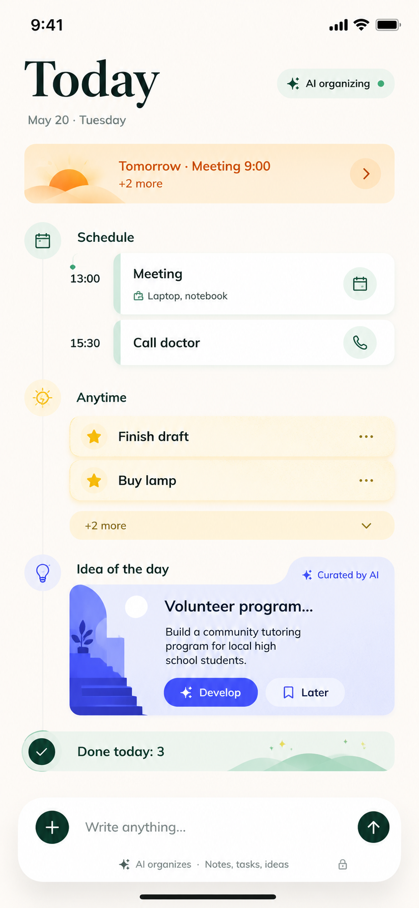
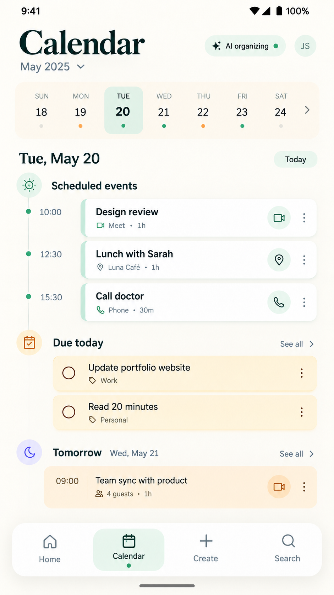
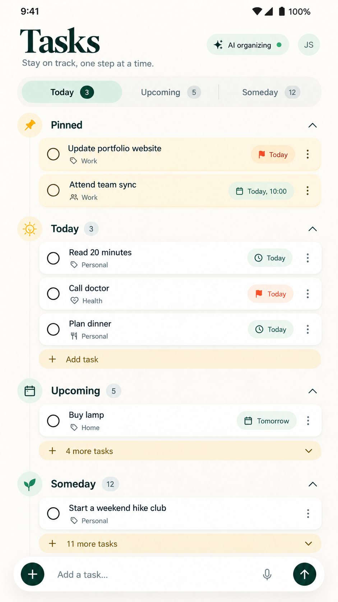
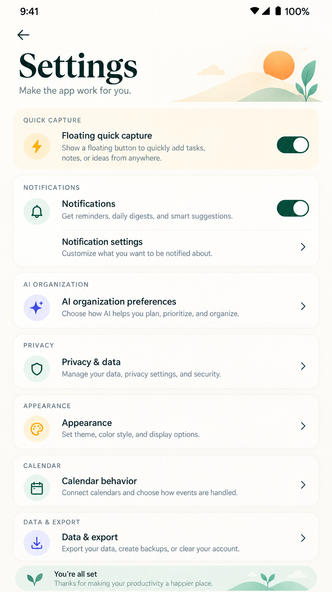
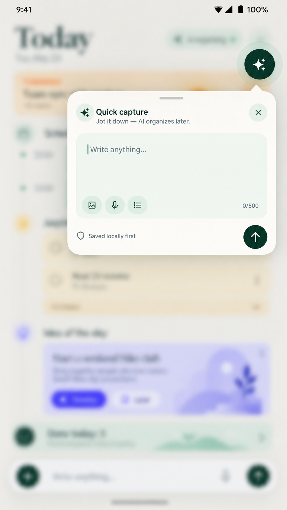

# Screens and UX

Reviewed **2026-11-20** under [ADR-018](DECISIONS.md#adr-018-semantic-composer-and-warm-organizer-screens). Emulator comparisons are in [Visual audit](VISUAL_AUDIT.md).

## Current navigation and interactions

[PlannerUI](../android/app/src/main/java/app/planner/features/PlannerUI.kt) owns Today, Calendar, Tasks, Ideas and Profile navigation. Profile links Journal, Review and Settings. The dark bar opens Semantic Composer as a temporary route over the originating screen. Closing returns there and retains the draft. Quick capture notifications route to the editor.

[Semantic Composer](../android/app/src/main/java/app/planner/features/SemanticComposer.kt) accepts free text. It shows blue entity/link, lavender idea and amber date/time outlines when the local reader recognizes supported fragments. Tapping a fragment opens a selector above it. A text menu exposes the same fragments for accessibility. Ambiguous bare hours offer morning and evening, followed by a date question when needed. Switching to date asks for the month containing the identified day. The preview exposes the selected kind and temporal fields. Manual mode and Note are available through the kind selector.

Save commits the original draft exactly as typed, with a confirmed structured record when selected. Automatic drafts without a recognized kind use plain capture. Confirmed dates and times form a real instant when the local zone has a unique offset. Partial event/time details stay visible in record details and Journal. The editor displays the current privacy mode. Consent authorizes future cloud saves and leaves existing private notes local. The keyboard and content scroll independently of the save bar.

## Shared design and UI states

[Design system](DESIGN_SYSTEM.md) owns bundled fonts/licenses, semantic color tokens, cards, icons and vector illustrations. Today uses a warm Onest/Manrope treatment. Calendar, Tasks, Ideas and Profile share the warm system. Journal, Review and Settings retain the earlier theme. Actual values/counts/identity/status come from local state. No fake user initials, provider activity, streaks or rewards.

| State | Actual behavior |
| --- | --- |
| Loading | Local read hint; capture remains available |
| Empty | Section-specific explanation and relevant add/navigation action |
| Query error | Distinct safe error and Try again; no fabricated empty-data claim |
| Saving / saved | Duplicate send guard; confirmation after Room commit; continued typing retained |
| Offline / pending | Local reading/editing works; cloud-eligible outbox persists |
| AI unavailable / failed | Honest Today/Journal status and Retry AI; private mode is explicit |
| Stale edit / invalid form | Retain form and explain correction/reopen requirement |
| Permission denied / revoked | Actual toggle state; in-app capture and notification alternative |

## Today

[TodayScreen](../android/app/src/main/java/app/planner/features/TodayScreen.kt) uses the current device date and locale. The date pill opens a native picker and hands the result to Calendar. The five-day strip starts on Today and opens the chosen date in Calendar. Profile and Settings are direct header actions.

One warm panel groups due tasks, chronological commitments, and the remaining Anytime focus. The Anytime selection remains pinned-first and initially capped at two. Deadline chips and appointment clocks read separate record fields. Task checkboxes complete with Undo or restore a completed task. Timed non-task records still open Details through their rows. Progress counts tasks in the Today query plus tasks actually completed today. The latest completion appears inline, with a disclosure when more are available.

Collection opens the existing Ideas route and reports the real saved-ideas count. The conditional tomorrow preview, persisted Idea of the day with Develop/Later, Review shortcut and connection status remain available below the panel. Empty, loading and error states display real local-query results. The privacy explanation remains available on first use.

The dark bar opens Semantic Composer. The existing five tabs include the Ideas and Profile routes. Voice capture has separate scope. Temporal predicates are documented in [Data model](DATA_MODEL.md#temporal-semantics).

## Calendar

Day, Week and Month modes share the selected date. Week scrolls horizontally through seven real date columns and timed records. Month uses the real month length and configured week start. The month label opens the native date picker. The selected-day agenda keeps appointments and planned/due tasks separate. Local empty/loading/error states are explicit. No external calendar writes or invented appointment duration.

## Tasks

Today & earlier, No date, Deadlines and Completed are direct filters. More views exposes All unfinished, Upcoming and Archived. Lists page 50 rows, pinned first. Pinned and ordinary sections collapse independently. Someday includes every task with no execution date, deadline or start. Earlier tasks remain reachable without red warning states. All unfinished resolves cross-date cases without silently changing dates.

Completion/Undo, Details, planned date/deadline editing, reschedule, pin/unpin and archive/restore all use the existing repository/records. Add task selects manual undated capture. Pagination and empty states preserve discoverability beyond the Today day-query bound.

## Profile

Local device identity or the connected workspace UUID prefix is shown without a fabricated name/photo. SQL aggregates show actual completed tasks, non-archived saved ideas, original notes and unfinished tasks. Registered type collections appear only when records exist. Journal, Review and Settings remain accessible; a new profile explains that capture starts the collection. No inferred personality/focus-time statistics.

## Journal and review

Journal pages 50 chronological original notes with timestamps, privacy/processing status, derived records, edit/manual interpretation and cloud-only Retry AI. Newer/Older uses the local database. Original text remains visible after corrections.

Review combines at most three persistent old-task slots and at most five ambiguous-note slots. Old tasks offer Today, Later (seven-day review snooze without a deadline), Smaller action (new linked action, original retained), Details and Let go (archive). Edited/rescheduled/completed/archived items leave the daily slot; slots do not refill immediately. Note review offers editable proposal titles and explicit interpretation dates, plus daily Later. Review never blocks capture.

## Ideas and suggestions

Ideas has a bound title/details search, 50-row paging and editable saved cards. Search follows SQLite LIKE behavior (ASCII case-insensitive, non-ASCII case-sensitive). Make a task creates a new raw note/task with provenance and the current capture privacy choice. A private source always produces a private task, and the original idea is preserved. Task Details links back to the source idea/action where available.

Develop keeps the existing durable AI job flow. Private ideas remain private and offer manual conversion; queued/running, unavailable, unconfigured, failed and stale states are distinct. Completed results expose 3–5 selectable steps; approval creates tasks atomically once after input/idea version checks. Live-provider behavior remains unverified.

## Record details

[RecordEditor](../android/app/src/main/java/app/planner/features/RecordEditor.kt) exposes original note, title, kind, versioned type/generic fields, separate planned day/deadline/start/end and pin/archive/restore/complete. Provenance IDs stay out of generic user fields and appear as a source link. Reminder editing is explicitly stored-only. Native time editing rejects DST gaps and asks which repeated occurrence to use. Save retains validation errors; Cancel discards unsaved values. Immediate pin/archive/complete acts on saved values; save form edits first.

## Settings

Grouped real controls cover floating capture, notification capture, AI endpoint/enrollment/sync, privacy, system/light/dark appearance, Sunday/Monday week start, export/clear and diagnostics. Rows expand into working controls. Timed reminders, notification digests, external calendars, cloud backups and other unimplemented options are omitted.

Export streams keyset pages into local schemaVersion=1 JSON without credentials. It is a best-effort export during concurrent edits; failure can leave a partial destination, and retry opens the picker again. Export disables simultaneous clear/export. Cancel changes nothing.

Clear requires confirmation, stops capture surfaces/work, serializes against sync, and clears Room/drafts/endpoint/credential/consent. New capture returns to private. Server copies remain. Terminal sync failures retain Retry / Send latest saved version / explicit Keep local conflict recovery.

## Quick-capture overlay

The existing native WindowManager service remains. A draggable 56 dp forest circle opens an ivory rounded panel with handle, shared sparkle icon, multiline mint field, privacy choice, close/send controls and local-save feedback. It draws original vector icons and bundled body font, and does not blur/read other apps.

| Interaction | Actual behavior |
| --- | --- |
| Enable | Explain permission; verify Android result; start from visible Activity |
| Tap | Restore draft/privacy, open field and request IME |
| Save | Shared Room capture with OVERLAY source; confirm locally before any network |
| Close / Back | Persist draft and collapse; predictive Back on API 33+ |
| Drag / rotate | Snap/remember normalized position; preserve draft and reposition |
| App foreground / lock | Hide windows; ordinary app/unlock restores when permitted |
| Disable / revoke | Stop service and remove windows/listeners |
| Notification fallback | Separate opt-in capture action opens the main composer |

Draft writes are debounced; explicit close flushes. Force-stop/process/storage failure can lose recent unsent keystrokes, while committed notes persist. The service uses specialUse, START_NOT_STICKY and a persistent notification. No boot resurrection promise. Physical/OEM/store limits remain acceptance gates.

## Reference gallery

These original pictures are copied unchanged into the repository. Values and system chrome are illustrative, not runtime evidence.

### Today concept

### Calendar concept

### Tasks

Tasks now has its own functional route; current captures and intentional differences are in [Visual audit](VISUAL_AUDIT.md).

### Settings concept

### Floating capture concept

## Reference differences and open UX decisions

Five primary navigation destinations and an always-available composer consume more height than the reference Calendar/Settings screens; these screens scroll. Real dates, counts, private mode, local identity and implemented setting descriptions replace fictional reference values. The Today card omits unearned Curated by AI attribution. The overlay uses the actual other-app background and visible Android keyboard, without blur. Original vector drawings approximate the reference motifs; they are not extracted commercial illustrations.

Current captures and screen-specific differences: [Visual audit](VISUAL_AUDIT.md). Full font/TalkBack/OEM coverage and live inference remain open. The old `assets/screens/*runtime*.png` files are October 15 historical evidence and are not the redesigned UI.
