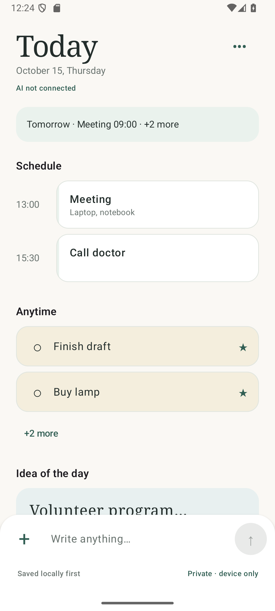
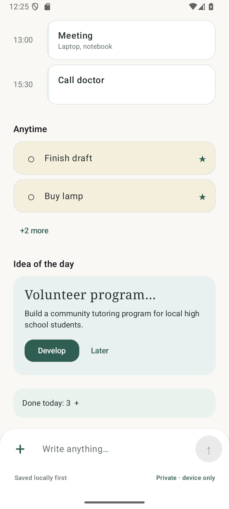
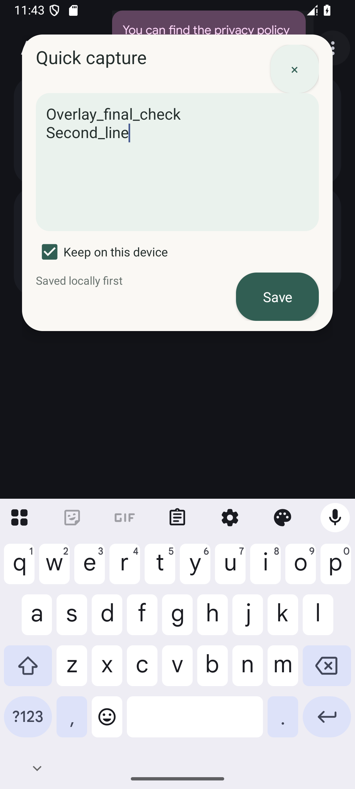

# Screens and UX concepts

Last reviewed: **2026-10-17**. Actual Compose/native behavior is described first; the five supplied pictures are **concept references**. Evidence and unexecuted gates: [Features](FEATURES.md), [Testing](TESTING.md). Intended principles: [Concept](CONCEPT.md).

## Current navigation and interactions

[PlannerUI](../android/app/src/main/java/app/planner/features/PlannerUI.kt) provides Today, Journal, Calendar, Ideas, Review and Settings through the header overflow. Shared dialogs edit records, organize notes and approve development suggestions. Back/dismiss returns to the underlying route. Composer stays available across routes, above navigation/IME insets. No chat, Search, month dashboard or full backlog is included.

The plus menu optionally selects manual Task for today / Idea / Event / Information, or Note for AI. No classification is required for ordinary capture. Save validates a 20,000-character limit without discarding an overlong main draft; the overlay input enforces the same limit. Drafts persist through DataStore. A remembered Private/Cloud AI choice applies **before** capture. Send confirms after Room commit, prevents duplicate in-flight submission and retains newly typed text when a prior save finishes. Local save failures retain input; later AI work never locks it.

## Shared design and UI states

[Theme tokens](../android/app/src/main/java/app/planner/core/designsystem/Theme.kt): ivory #FAF8F4, charcoal #232D2B, muted teal #315E53, mint #EAF2ED, sand #F4EEDD, idea blue-green #E8F0F0, secondary #69736F. Serif page headings, sans-serif content, rounded 16–24 dp cards, restrained borders, consistent spacing and at least 48 dp interactive targets. Dark tokens follow system settings. No decorative AI imagery or gamification. Original lavender/orange reference colors are historical; [ADR-011](DECISIONS.md#adr-011-current-implementation-and-calmer-today-direction) records the calmer direction.

| State | Implemented behavior |
| --- | --- |
| Local loading | “Reading saved data…”; composer remains available |
| Empty | Section-specific text and relevant capture/add action |
| Local query error | Safe error plus Try again; empty and failure are distinct |
| Saving / saved | Single in-flight draft save; confirmation only after commit; continued capture permitted |
| Offline / sync pending | Read/edit local records; queued work persists; connection status remains separate |
| AI unavailable / failed | Honest status and Journal Retry AI; saved notes remain accessible |
| Review required | Original input + proposal titles; user chooses interpretation and dates; daily deferral |
| Stale edit / save error | Retain record form and explain validation/reopen requirement |
| Permission denied / revoked | Actual toggle state, explanation, in-app capture and optional notification fallback |

Main status precedence: local read error/loading → initial local status → review → offline → expired enrollment → unconnected backend → unconfigured AI → failed processing → pending organizing → all organized. It never displays a fabricated successful provider result.

## Today

Actual date uses device locale/day context; no sample date is hardcoded. Room-backed sections:

| Section | Behavior |
| --- | --- |
| Tomorrow preview | Hidden without a scheduled item; earliest scheduled title/time plus count of remaining qualifying tomorrow records; tap opens Calendar on tomorrow |
| Schedule | Chronological timed tasks/events and continuing spans; known details only; continuing spans show Ongoing/continues; tap edits; deadlines do not become meeting times |
| Anytime | Untimed qualifying tasks; pins first, then creation order; up to two visible initially; +N more / Show less; completion and details |
| Idea of the day | First eligible saved idea persisted for that day; title/details, Develop/Later and details; optional rather than an obligation |
| Done today | Actual completion count; expand to restore items; no streaks, confetti or progress bar |
| Capture | Persistent multiline text, plus/type menu, save, privacy choice and local-first trust line |

All task actions persist locally: completion/undo, title/kind/type/field edits, pin, reschedule and archive. Scheduled task completion is available in Details. Later hides the idea until tomorrow without replacing today's slot. Empty sections remain meaningful. Exact inclusion/timezone policy: [Data model](DATA_MODEL.md#temporal-semantics).

## Calendar

A day view has previous/next controls, native date picker and Today shortcut. Scheduled records and planned/due tasks use separate groups, with explicit deadline labels. Known details/timezone conversions appear from records. Native time editing rejects DST gaps and asks first/second occurrence during overlap. All data and edits work offline; no external calendar write.

## Journal and review

Journal pages contain 50 chronological original captures with timestamp, private/processing label, derived records, and organization/reprocess actions. Newer/Older controls page local data. Remote raw-text revisions, if present, appear separately from original text.

Review reads at most five ambiguous notes. Proposal titles can be selected as a starting point; the user chooses kind/title/planned day and saves a confirmed interpretation. Later stores daily deferral. Notes with existing records edit through their Details buttons; adding interpretation is explicit. Review does not block capture.

## Ideas and suggestions

Ideas shows persisted pending ideas with details, edit/archive and Develop. A private idea refuses cloud development and offers manual next steps. Development results are observed from an individual Room job metadata row. Queued/running, unconfigured, offline/unavailable, stale and failed results are explained with retry/close. Completed jobs expose 3–5 selectable proposals. Explicit approval creates tasks atomically once; current idea/job versions and approved-step membership are checked. Live provider behavior remains unverified.

## Record details

[RecordEditor](../android/app/src/main/java/app/planner/features/RecordEditor.kt) exposes original note, editable title/kind, optional versioned type, generic primitive fields, planned date, separate date-only/instant deadline, scheduled start/end, and pin/archive/restore/complete. Known reminder time is editable with an explicit stored-only explanation. Validation errors retain values. Cancel discards unsaved changes. Immediate pin/archive/complete actions act on the saved record and close the form; save edits before using those actions.

## Settings

[Settings](../android/app/src/main/java/app/planner/features/SettingsScreen.kt) includes real overlay/notification controls, endpoint + masked one-time invitation, connection/provider state, Sync now, privacy, JSON export, confirmed device-only clear, version and safe timing/sync diagnostics.

Export streams 50-note keyset pages with records and a schemaVersion=1 envelope; credentials are excluded. Exporting disables another export/clear. It is a best-effort reading during concurrent edits, not a transactional backup; a failed write may leave a partial destination and retry requires choosing an export again. Canceling the picker changes nothing.

Clear cancellation preserves data. Confirmation stops capture windows/notification, cancels work, serializes against sync, clears Room, drafts, endpoint and credential. Server copies remain. Export first if wanted. Settings also exposes terminal-operation retry, Send the latest saved version for rejected record edits, and explicit Keep this device's version for revision conflicts.

## Quick-capture overlay

[OverlayService](../android/app/src/main/java/app/planner/features/overlay/OverlayService.kt) owns a 56 dp deep-teal bubble and scrollable ivory/mint native panel. Default is upper-right below system controls. Drag is distinct from tap, snaps to the nearest horizontal edge, and remembers normalized position.

| Interaction | Behavior |
| --- | --- |
| Enable | Explain draw-over permission, open Android settings, verify on return and start from visible Activity |
| Tap | Open multiline panel, restore draft/privacy, request keyboard focus |
| Save | Shared repository/Room transaction with OVERLAY source; confirm before network, clear submitted draft and collapse |
| Close / Back | Persist draft and collapse; API 33+ predictive Back supported |
| Save failure | Keep panel/draft, explain failure; blank/in-flight duplicate send disabled |
| Rotation | Preserve draft, collapse/reposition within new display bounds |
| Main app / lock | Hide windows while Planner is foreground or screen is locked |
| Disable / revoke | Stop service, release windows/listeners immediately; saved notes remain |
| Notification fallback | Opt-in permission-controlled capture action opens/focuses the main composer |

Draft updates are conflated/debounced in application scope, and explicit close flushes storage. Process death/force-stop/storage failure can lose recent **unsent** keystrokes; committed notes survive. Service is specialUse foreground with a persistent generic notification, START_NOT_STICKY, no boot resurrection. Secure Android windows may suppress it. It never reads other-app content or clipboard. Physical-device/OEM/Play validation remains pending.

## Reference gallery

These original pictures are copied unchanged into the repository. Values and system chrome are illustrative, not runtime evidence.

### Today concept

### Calendar concept

### Tasks

Standalone Tasks is a concept extension. Required task actions are implemented through Today, Calendar and Details; a dedicated backlog/filter route is not delivered.

### Settings concept

### Floating capture concept

## Reference differences and open UX decisions

No fake identities/counts/AI attribution, purple AI treatment, decorative illustrations, media/microphone buttons, 500-character cap, external calendar connection, Search, advanced notification preferences or cloud backups are inferred from reference pictures. Navigation, privacy, temporal membership and daily idea policy are now resolved in [Decisions](DECISIONS.md). Further work is verification on large fonts/small devices/dark mode, localized UI copy (currently English), reminder scheduling and large-dataset pagination.

Runtime images below have explicit fixture/provenance captions. Related: [UX behavior index](UX_BEHAVIOR.md), [Features](FEATURES.md).

## Runtime screenshots

*API 36 emulator, captured 2026-10-15 host date. Both images are scroll positions of one actual Compose Today screen. Date/time follow the emulator's timezone. Contents are private manual records created by the explicitly invoked PreviewFixtureTest; production startup seeds no notes and no live AI result is implied. The bottom composer remains docked while scrolling.*

*Actual opt-in overlay above the ordinary Clock app; manual multiline text, local-only choice and IME. No screen-content reading or pictured blur is implemented.*
