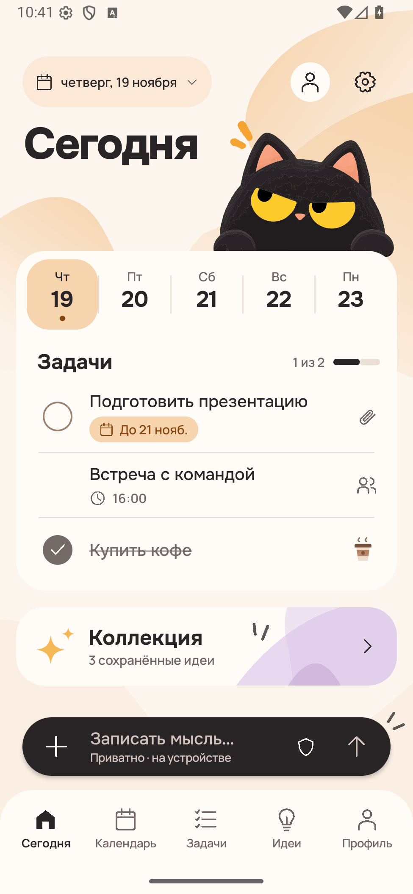
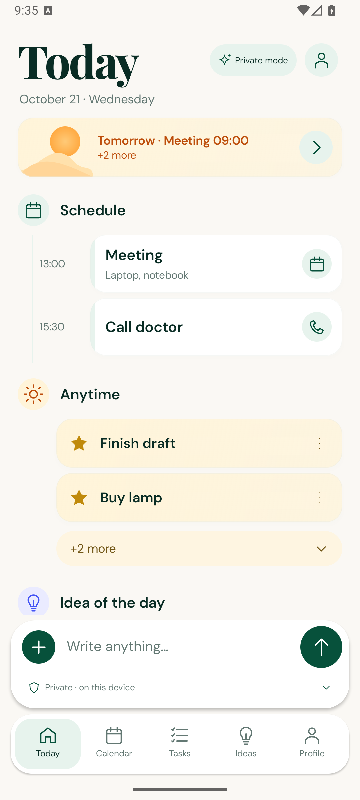
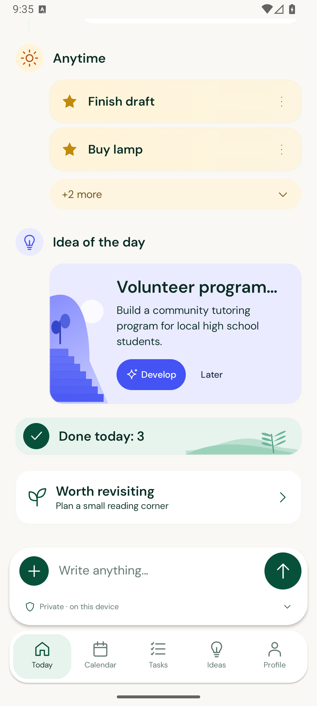
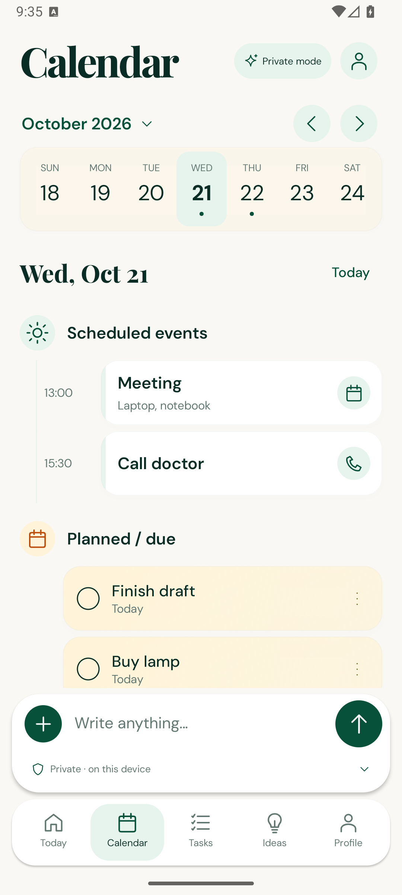
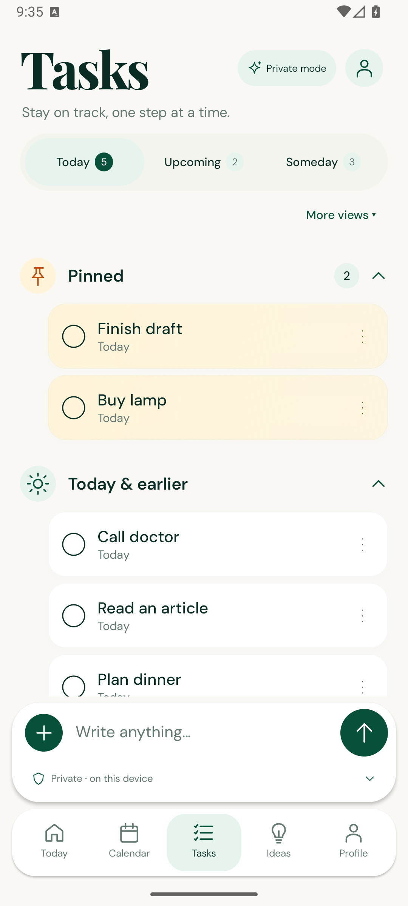
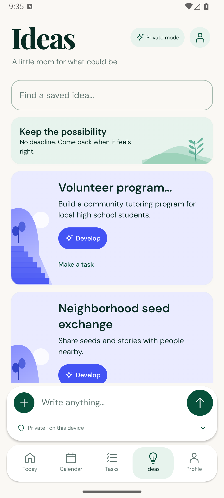
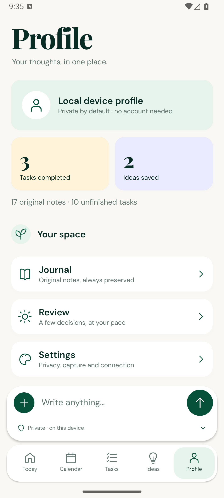
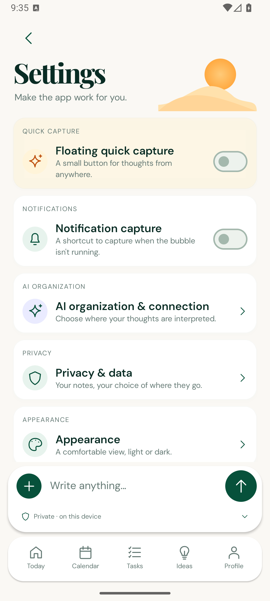
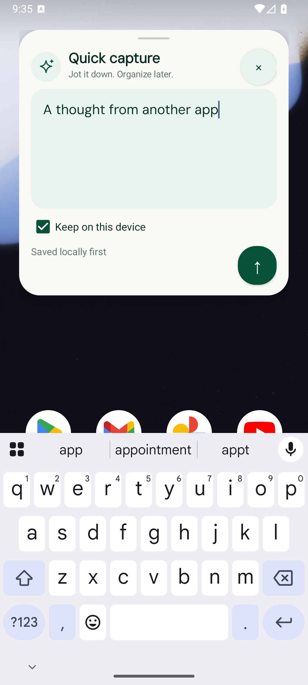

# Visual audit

## 2026-11-20 Semantic Composer and organizer

The Today file in the v2 ZIP is pixel-identical to [the approved Today image](assets/screens/today-approved-warm.png). The supplied SVG/WebP cat pair matches the bundled assets byte for byte. The other package images are composition concepts. Comparisons show the package reference on the left and the actual API 36 emulator on the right, each scaled to 390 dp width at its original aspect ratio.

- [Today render](assets/runtime/2026-11-20/today.png) and [approved comparison](assets/runtime/2026-11-20/today-comparison.png). The shared capsule replaces the inline editor and privacy row. Tapping opens the dedicated editor. The device supplies the date, status icons and gestures.
- [Calendar Week](assets/runtime/2026-11-20/calendar.png), [Month](assets/runtime/2026-11-20/calendar-month.png) and [Week concept comparison](assets/runtime/2026-11-20/calendar-comparison.png). The compact mascot and week alignment keep the selected day and more of the timeline visible. The grid scrolls horizontally. Event cards use a readable minimum height and detail rows retain exact time. The agenda puts planned tasks and deadlines in a separate group.
- [Tasks render](assets/runtime/2026-11-20/tasks.png) and [concept comparison](assets/runtime/2026-11-20/tasks-comparison.png). The filter row gives the longer Completed label more space. Real task rows share a panel and thin dividers. Later uses the existing Upcoming query.
- [Ideas render](assets/runtime/2026-11-20/ideas.png) and [concept comparison](assets/runtime/2026-11-20/ideas-comparison.png). The first real saved idea gets the lavender accent. Search, theme grouping, Develop and Make a task are working controls. There is no synthesized featured content.
- [Profile render](assets/runtime/2026-11-20/profile.png) and [concept comparison](assets/runtime/2026-11-20/profile-comparison.png). A local device profile and actual Room counts fill the identity and statistics panel. Journal, Review and Settings preserve their working entry points.
- [Anchored composer selector](assets/runtime/2026-11-20/composer-token.png), [date clarification](assets/runtime/2026-11-20/composer-question.png), [resolved preview](assets/runtime/2026-11-20/composer-ready.png) and [composer concept comparison](assets/runtime/2026-11-20/composer-token-comparison.png). The Russian dentist example shows dashed text bounds, a popup above the ambiguous fragment, and the next question below the editor. App privacy and text-menu actions replace illustrative media buttons. The confirmed record uses the same raw text and the date/time chosen in the editor.

The organizer follows the established five-destination navigation. A [360 dp enlarged-text capture](assets/runtime/2026-11-20/composer-360dp.png) illustrates scrolling and the anchored selector at font scale 1.4. See [Testing](TESTING.md#2026-11-20-semantic-composer-v2) for executed scope.

## 2026-11-19 warm Today

The [approved Today image](assets/screens/today-approved-warm.png) sets the visual target. [First emulator pass](assets/runtime/2026-11-19/today-first-pass.png) and [final emulator pass](assets/runtime/2026-11-19/today-390.png) use actual persisted private fixture records. The [comparison](assets/runtime/2026-11-19/today-reference-comparison.png) shows a 50% overlay on the left and absolute RGB difference on the right at 390×844. It is a geometry aid. Device chrome, content, font rasterization and destination changes contribute to the difference.

The first comparison drove five corrections.

1. The upper-right peach shape had a straight inner edge. A continuous contour now curves behind the header and mascot.
2. The mascot sat fully above the panel. Its supplied transparent artwork now peeks behind the top edge and leaves all five dates clear.
3. The bottom of the task panel showed square corners and a trailing divider. The last live row shares the rounded bottom with the panel actions.
4. The Collection card was cropped at the fold. The dark composer now fits its privacy label and control alongside the text field, so the full collection card is visible at 390 dp.
5. The calendar/header controls sat high and the navigation compressed the composer gap. Revised insets and spacing align the title, panel and collection more closely with the supplied composition.

The [360 dp / 140% text capture](assets/runtime/2026-11-19/today-360-large-text.png) stacks the mascot below the title. The task title and long date wrap, and the nav allocates extra width to its longer labels. Larger-text content scrolls past the fold. The [dark capture](assets/runtime/2026-11-19/today-390-dark.png) uses the warm dark palette. The [keyboard capture](assets/runtime/2026-11-19/today-390-keyboard.png) shows the live IME and composer, with tabs hidden while typing.

The fixture uses the device date, computed progress and saved-ideas count. Collection opens Ideas. Android supplies the system chrome. The five working destinations remain visible, including Tasks and Profile. The composer uses its working save button and explicit privacy controls. The provided vector pair has taller proportions and amber accent marks. These are visible differences from the approved PNG. Collection/Inbox routes and voice capture have separate scope.

The supplied asset catalog was used as a visual guide. The named handoff document paths were absent from the checkout. The available design token JSON, approved PNG, verified cat asset pair and scene vectors supplied the implementation details. The existing two design-system component goldens represent the earlier shared palette and were checked separately.

## 2026-10-21 reference and device audit

2026-10-21. Status: **Verified on the documented emulator configurations**. The five unchanged references are visual targets. Runtime captures below are actual interactive Compose/native screens populated only by the explicitly invoked QA fixture. They are not production seed data or live AI results.

## Environment and provenance

Dedicated disposable `Planner_Visual_QA`, API 36 Google Play x86_64, 1080×2400 at density 420, font scale 1.0, device timezone GMT. Host: Windows 11, Studio 2026.2.2, bundled JBR 25.0.4, existing AGP 9.4.1/Gradle 9.6.0. The user's existing emulator was not cleared. Native overlay permission was granted to the QA app for the automated capture run; its local save was asserted in Room.

Additional rendering: 945×2100 at the same density (360 dp width), font scale 1.4, plus actual dark-theme Today. Temporary device overrides are reset after the run. [Testing](TESTING.md) owns executed counts/commands; [Design system](DESIGN_SYSTEM.md) owns tokens, licenses and components.

## Reference comparison

| Screen | Reference | Actual capture | Matching composition | Intentional differences / remaining scope |
| --- | --- | --- | --- | --- |
| Today top | [today.png](assets/screens/today.png) | [Today top](assets/runtime/2026-10-21/visual-audit/today-top.png) | Editorial serif/date, quiet status pill, apricot sunrise preview, mint schedule rail/cards, sand focus pool and floating composer | Actual date/status/counts, real profile icon; extra persistent primary navigation requires scrolling |
| Today bottom | [today.png](assets/screens/today.png) | [Today bottom](assets/runtime/2026-10-21/visual-audit/today-bottom.png) | Two-item collapsed focus, lavender illustrated idea/actions, mint done recap | Original simplified stair/plant drawing; manual ideas have no invented AI-curation label; bounded review link follows the recap |
| Calendar | [calendar.png](assets/screens/calendar.png) | [Calendar](assets/runtime/2026-10-21/visual-audit/calendar.png) | Serif heading, month navigation, rounded seven-day strip/selected date, timeline and separate task cards | Persistent capture, five real destinations, no Search placeholder; real agenda may differ from pictured event counts |
| Tasks | [tasks.png](assets/screens/tasks.png) | [Tasks](assets/runtime/2026-10-21/visual-audit/tasks.png) | Editorial heading, counted mint filters, pinned sand cards, outlined completion, expandable groups and add row | Filters show one paginated bucket at a time; earlier tasks remain discoverable without red states; archived/completed recovery is in More views |
| Ideas | Shared Today vocabulary | [Ideas](assets/runtime/2026-10-21/visual-audit/ideas.png) | Lavender idea cards, original vector motif, green/lavender hierarchy | No separate supplied Ideas reference; adds real saved-idea search, conversion and paging |
| Profile | Shared Today/Settings vocabulary | [Profile](assets/runtime/2026-10-21/visual-audit/profile.png) | Serif header, mint identity surface, sand/lavender metrics, rounded navigation cards | No supplied Profile picture; uses local/workspace identity and measured counts only |
| Settings | [settings.png](assets/screens/settings.png) | [Settings](assets/runtime/2026-10-21/visual-audit/settings.png), [lower groups](assets/runtime/2026-10-21/visual-audit/settings-bottom.png) | Serif header/sunrise, uppercase group labels, rounded cards, circular glyphs, switches/chevrons and landscape footer | Only working notification capture, appearance/week-start, connection/privacy/export/diagnostic options; groups expand and page scrolls |
| Floating capture | [quick-capture.png](assets/screens/quick-capture.png) | [Quick capture](assets/runtime/2026-10-21/visual-audit/quick-capture.png) | Forest bubble, ivory rounded panel/handle, mint multiline field, close/send controls and privacy/trust line | Actual other-app background and keyboard; no screen blur or inactive media controls; 20,000-character storage limit rather than fictional 500 |

## Empty/private first use

[Actual first-use capture](assets/runtime/2026-10-21/visual-audit/welcome-private.png) shows a nonblocking explanation, private composer and real empty states. No note is uploaded by viewing the explanation. The first-use fixture passed separately from seeded screen comparisons.

## Runtime gallery

## Responsive and accessibility compromises

At 140% font scale the header status moves onto its own line, filters stack counts below their labels, and Settings omits the decorative landscape behind text. Cards/text grow and the page scrolls; the composer remains above navigation/keyboard. Main actions use 48 dp touch targets. Five labels remain accessible in the navigation semantics. The fixed week strip is compact; physical-device/TalkBack and larger font/API/OEM coverage remain open.

The corrected [small/font-scale captures](assets/runtime/2026-10-21/small-font-140/visual-audit/tasks.png) and [dark Today](assets/runtime/2026-10-21/visual-audit/today-dark.png) supplement the default comparison. Original vector art, bundled font substitution, Android-owned chrome, truthful private state and larger working touch targets intentionally prevent exact raster equality with fictional reference screenshots.

## Iteration and regression scope

Rendered review corrected variable-font weights, strong bottom shadows, Profile tab restoration, missing week markers, and a clipped Upcoming count at 140% scale. The current screenshots replace interim captures; the original references remain unchanged. Earlier `assets/screens/*runtime*.png` images describe the October 15 UI, and `first-today.png` in the new directory is the initial October 21 iteration.

Two fixed-data light/dark [component goldens](../android/app/src/androidTest/assets/goldens/design-system-light.png) are verified by [DesignSystemScreenshotTest](../android/app/src/androidTest/java/app/planner/DesignSystemScreenshotTest.kt). Comparison allows at most 0.5% changed pixels with a per-channel threshold of 16 on the pinned emulator configuration. Whole-screen reference comparison is human-reviewed; it does not claim automated pixel equivalence or representative performance measurements. Do not regenerate goldens simply to hide a failure.
