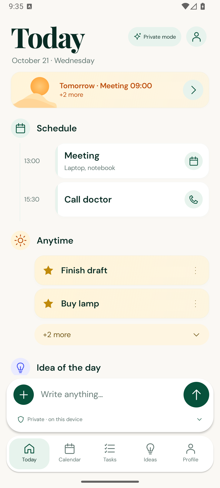
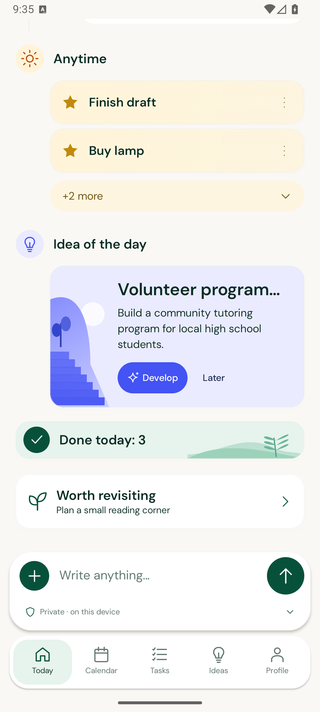
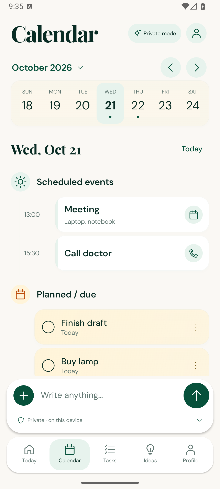
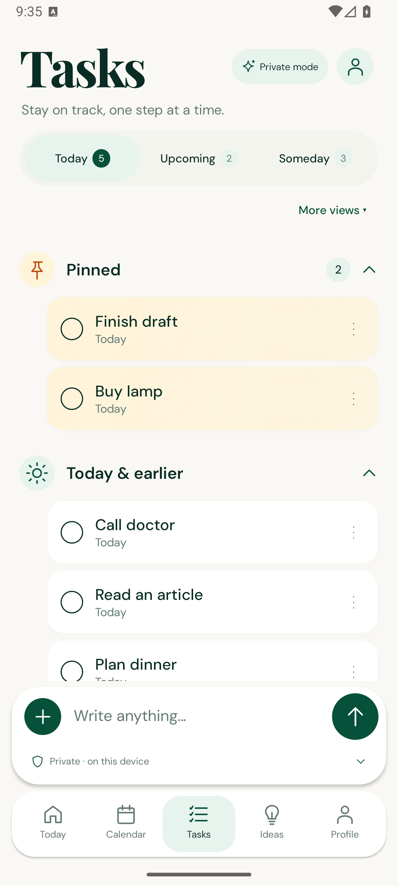
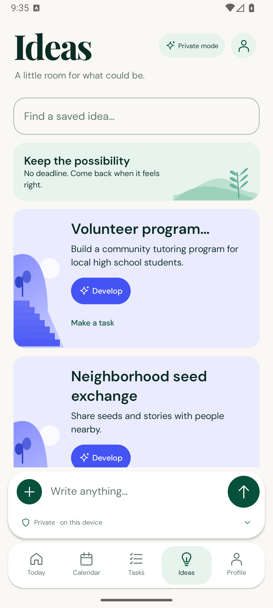
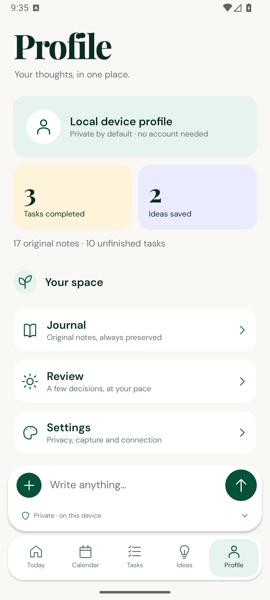
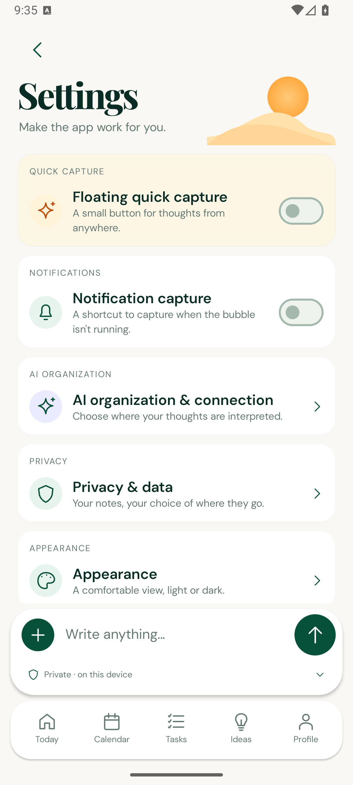
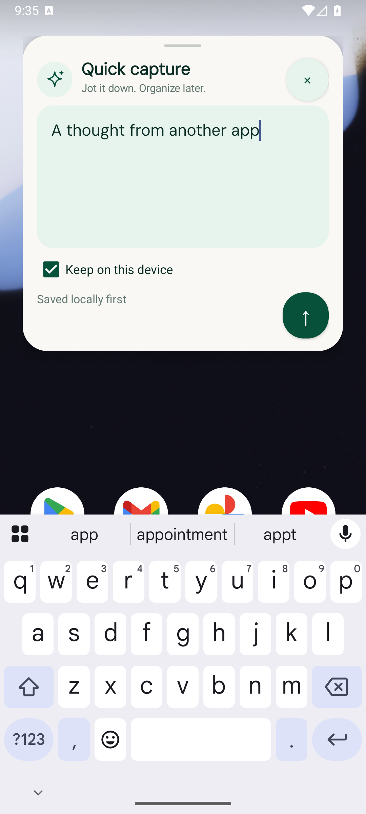

# Visual audit

2026-10-21. Status: **Verified on the documented emulator configurations**. The five unchanged references are visual targets. Runtime captures below are actual interactive Compose/native screens populated only by the explicitly invoked QA fixture. They are not production seed data or live AI results.

## Environment and provenance

Dedicated disposable `Planner_Visual_QA`, API 36 Google Play x86_64, 1080×2400 at density 420, font scale 1.0, device timezone GMT. Host: Windows 11, Studio 2026.2.2, bundled JBR 25.0.4, existing AGP 9.4.1/Gradle 9.6.0. The user's existing emulator was not cleared. Native overlay permission was granted to the QA app for the automated capture run; its local save was asserted in Room.

Additional rendering: 945×2100 at the same density (360 dp width), font scale 1.4, plus actual dark-theme Today. Temporary device overrides are reset after the run. [Testing](TESTING.md) owns executed counts/commands; [Design system](DESIGN_SYSTEM.md) owns tokens, licenses and components.

## Reference comparison

| Screen | Reference | Actual capture | Matching composition | Intentional differences / remaining scope |
| --- | --- | --- | --- | --- |
| Today top | [today.png](assets/screens/today.png) | [Today top](assets/runtime/2026-10-21/visual-audit/today-top.png) | Editorial serif/date, quiet status pill, apricot sunrise preview, mint schedule rail/cards, sand focus pool and floating composer | Actual date/status/counts, real profile icon; extra persistent primary navigation requires scrolling |
| Today bottom | [today.png](assets/screens/today.png) | [Today bottom](assets/runtime/2026-10-21/visual-audit/today-bottom.png) | Two-item collapsed focus, lavender illustrated idea/actions, mint done recap | Original simplified stair/plant drawing; manual ideas have no invented AI-curation label; bounded review link follows the recap |
| Calendar | [calendar.png](assets/screens/calendar.png) | [Calendar](assets/runtime/2026-10-21/visual-audit/calendar.png) | Serif heading, month navigation, rounded seven-day strip/selected date, timeline and separate task cards | Persistent capture, five real destinations, no Search placeholder; real agenda may differ from pictured event counts |
| Tasks | [tasks.png](assets/screens/tasks.png) | [Tasks](assets/runtime/2026-10-21/visual-audit/tasks.png) | Editorial heading, counted mint filters, pinned sand cards, outlined completion, expandable groups and add row | Filters show one paginated bucket at a time; earlier tasks remain discoverable without red states; archived/completed recovery is in More views |
| Ideas | Shared Today vocabulary | [Ideas](assets/runtime/2026-10-21/visual-audit/ideas.png) | Lavender idea cards, original vector motif, green/lavender hierarchy | No separate supplied Ideas reference; adds real saved-idea search, conversion and paging |
| Profile | Shared Today/Settings vocabulary | [Profile](assets/runtime/2026-10-21/visual-audit/profile.png) | Serif header, mint identity surface, sand/lavender metrics, rounded navigation cards | No supplied Profile picture; uses local/workspace identity and measured counts only |
| Settings | [settings.png](assets/screens/settings.png) | [Settings](assets/runtime/2026-10-21/visual-audit/settings.png), [lower groups](assets/runtime/2026-10-21/visual-audit/settings-bottom.png) | Serif header/sunrise, uppercase group labels, rounded cards, circular glyphs, switches/chevrons and landscape footer | Only working notification capture, appearance/week-start, connection/privacy/export/diagnostic options; groups expand and page scrolls |
| Floating capture | [quick-capture.png](assets/screens/quick-capture.png) | [Quick capture](assets/runtime/2026-10-21/visual-audit/quick-capture.png) | Forest bubble, ivory rounded panel/handle, mint multiline field, close/send controls and privacy/trust line | Actual other-app background and keyboard; no screen blur or inactive media controls; 20,000-character storage limit rather than fictional 500 |

## Empty/private first use

[Actual first-use capture](assets/runtime/2026-10-21/visual-audit/welcome-private.png) shows a nonblocking explanation, private composer and real empty states. No note is uploaded by viewing the explanation. The first-use fixture passed separately from seeded screen comparisons.

## Runtime gallery

## Responsive and accessibility compromises

At 140% font scale the header status moves onto its own line, filters stack counts below their labels, and Settings omits the decorative landscape behind text. Cards/text grow and the page scrolls; the composer remains above navigation/keyboard. Main actions use 48 dp touch targets. Five labels remain accessible in the navigation semantics. The fixed week strip is compact; physical-device/TalkBack and larger font/API/OEM coverage remain open.

The corrected [small/font-scale captures](assets/runtime/2026-10-21/small-font-140/visual-audit/tasks.png) and [dark Today](assets/runtime/2026-10-21/visual-audit/today-dark.png) supplement the default comparison. Original vector art, bundled font substitution, Android-owned chrome, truthful private state and larger working touch targets intentionally prevent exact raster equality with fictional reference screenshots.

## Iteration and regression scope

Rendered review corrected variable-font weights, strong bottom shadows, Profile tab restoration, missing week markers, and a clipped Upcoming count at 140% scale. The current screenshots replace interim captures; the original references remain unchanged. Earlier `assets/screens/*runtime*.png` images describe the October 15 UI, and `first-today.png` in the new directory is the initial October 21 iteration.

Two fixed-data light/dark [component goldens](../android/app/src/androidTest/assets/goldens/design-system-light.png) are verified by [DesignSystemScreenshotTest](../android/app/src/androidTest/java/app/planner/DesignSystemScreenshotTest.kt). Comparison allows at most 0.5% changed pixels with a per-channel threshold of 16 on the pinned emulator configuration. Whole-screen reference comparison is human-reviewed; it does not claim automated pixel equivalence or representative performance measurements. Do not regenerate goldens simply to hide a failure.
